[Español](README.md) · **English**

  <a href="https://juandelmazovazquez.github.io/shuffl/?demo=1">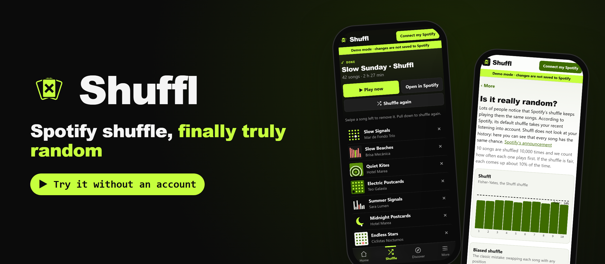</a>

<h1 align="center">Shuffl</h1>

<b>Spotify shuffle, finally truly random.</b> 
A free, open-source web app that puts your playlists in random order, with the same chance for every song. No server, no new accounts and no analytics.

  
  
  
  

  
  &nbsp;
  

  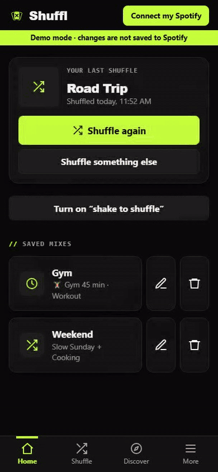

## The problem

When I used Spotify, I noticed shuffle kept playing me the same songs. Sometimes it even got stuck in a kind of loop, repeating a small group over and over, even though my playlists have many more. I looked it up and saw I was not the only one: people in Spotify's forums have been describing the same thing for years ([1](https://community.spotify.com/forum/en/discussion/4880594/all-platforms-option-to-have-a-true-shuffle), [2](https://community.spotify.com/forum/en/discussion/5280042/shuffle-mode-playing-the-same-songs-all-the-time), [3](https://community.spotify.com/forum/en/discussion/7037040/add-a-true-random-shuffle-option)).

That is how Shuffl started: **a truly random shuffle, where every song has the same chance**. According to Spotify itself, its default shuffle (Fewer Repeats) [takes your recent listening into account](https://newsroom.spotify.com/2025-11-13/shuffle-update-fewer-repeats/); Shuffl does not look at your history: it puts your playlist in random order and Spotify plays it as is. And you can check it in the app:

  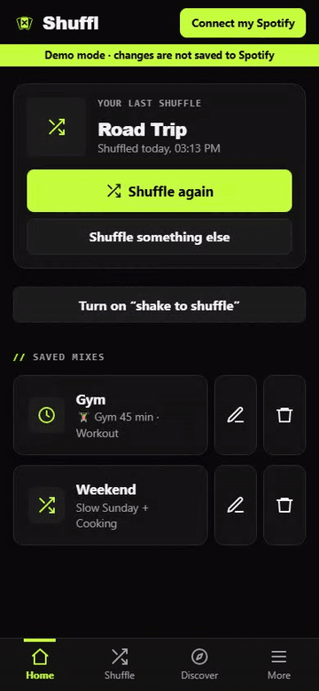

## Features

<table>
  <tr>
    <td align="center" width="25%">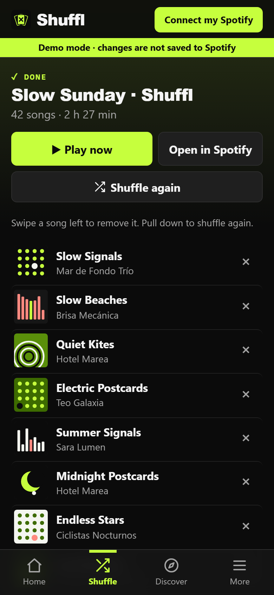 <b>Real shuffle</b> One or more playlists and Liked Songs, with filters and no duplicates.</td>
    <td align="center" width="25%">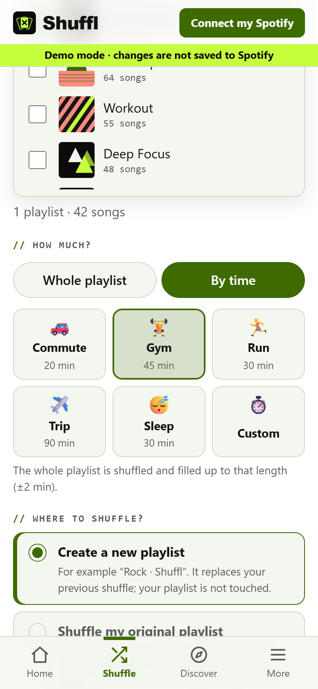 <b>By time</b> Gym 45 min, Commute 20 or custom from 5 to 180 min.</td>
    <td align="center" width="25%">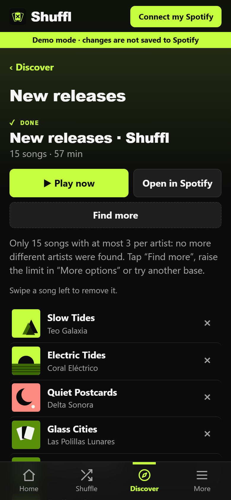 <b>New releases and Explore</b> Releases from your artists and songs you do not have yet.</td>
    <td align="center" width="25%">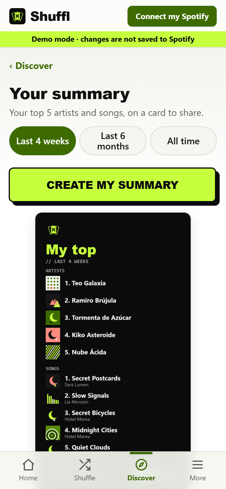 <b>Your summary</b> Your top on a card to share.</td>
  </tr>
  <tr>
    <td align="center">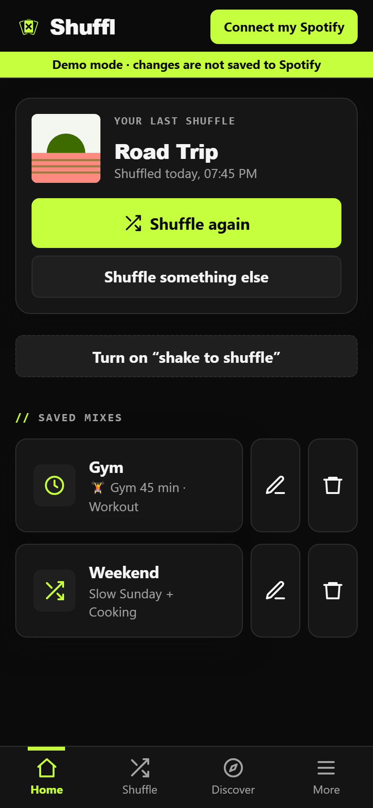 <b>One tap</b> Shuffle again, saved mixes, Siri shortcuts and shake to shuffle.</td>
    <td align="center">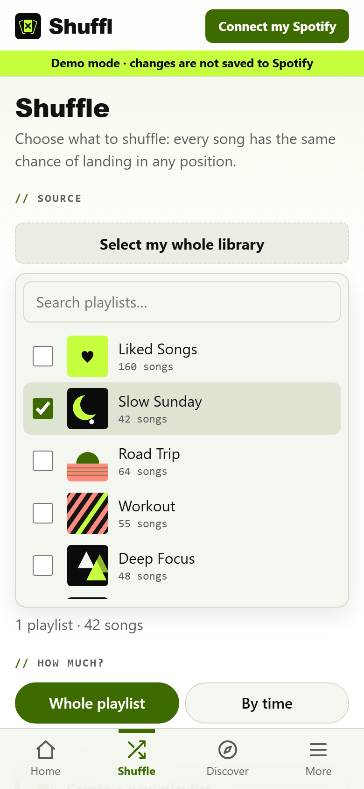 <b>Play now</b> Starts it on your Spotify with shuffle off and checks it is playing.</td>
    <td align="center">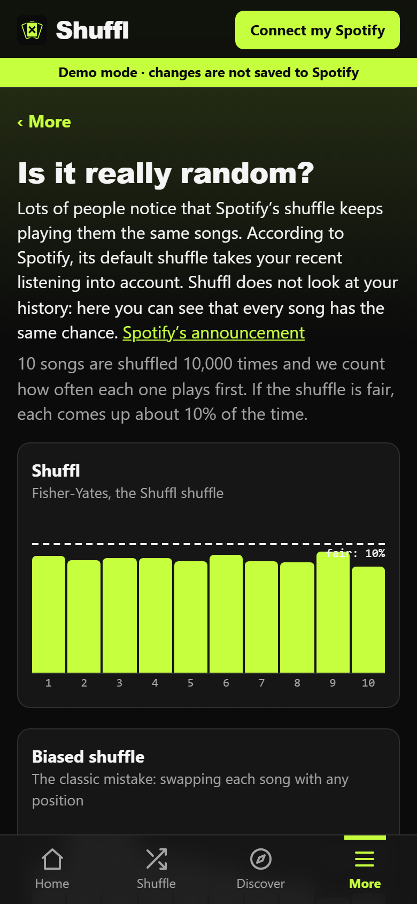 <b>Is it random?</b> 10,000 shuffles simulated on your phone, with a chart and a table.</td>
    <td align="center">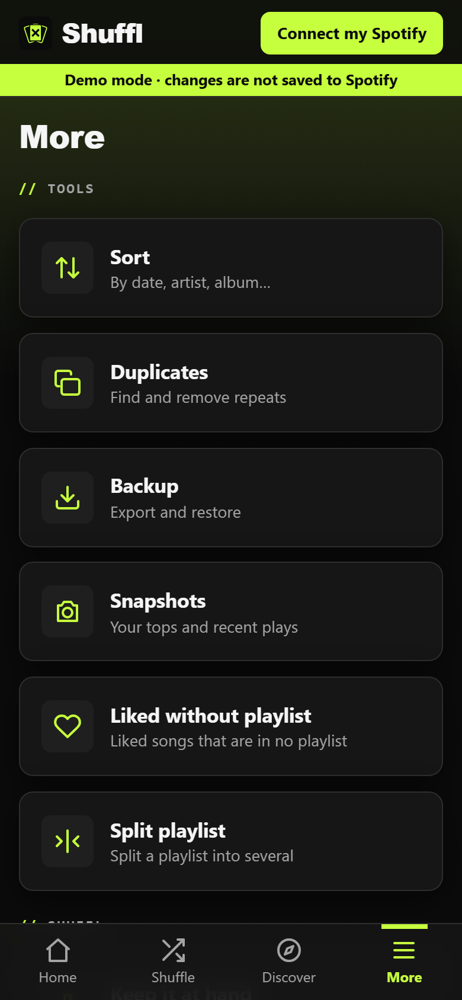 <b>And more tools</b> Sort, duplicates, backup, split, snapshots and Undo.</td>
  </tr>
</table>

Every feature in detail: [docs/FEATURES.md](docs/FEATURES.md). Dark and light themes, in English and Spanish.

  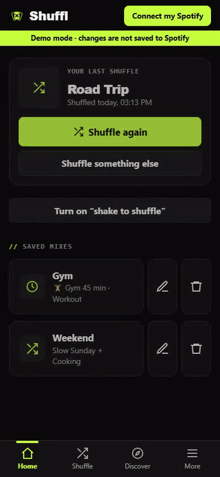

## Get started in 5 minutes

**Just want to look around?** Open the [demo](https://juandelmazovazquez.github.io/shuffl/?demo=1): made-up data, no account and no changes to Spotify.

**With your Spotify** it takes three steps, only once and in this order, so you do not have to sign in twice:

1. **Install Shuffl on your phone.** iPhone: open [the app](https://juandelmazovazquez.github.io/shuffl/) in Safari, tap Share and choose “Add to Home Screen”. Android: open it in Chrome, tap the ⋮ menu and choose “Install app”. **Do not sign in in the browser yet**: on iPhone, Safari and the installed app keep their data separately.
2. **From the installed app, create your app in Spotify for Developers.** Tap “Create app” and fill in the form: App name “Shuffl”, any App description, Website empty, in Redirect URIs paste `https://juandelmazovazquez.github.io/shuffl/` (with the trailing slash) and tap “Add”, tick “Web API”, accept the terms and tap “Save”. The Client ID is on your app’s page: you do not need to open Settings.
3. **Paste the Client ID in the installed app and connect.**

  

The guide explains each field of the Spotify form, with a button to copy the Redirect URI, and what to do if something fails. Inside the app, the setup assistant on the start screen follows the same steps and **More → Diagnostics** runs a full check with your account.

> **Set it up before v1.4.1?** Shuffl has moved to `https://juandelmazovazquez.github.io/shuffl/`. The old address redirects here, but Spotify only accepts sign-in on a Redirect URI it knows: on your app’s page in Spotify for Developers, open **Settings** → **Edit** → **Redirect URIs**, add the new address (with the trailing slash), tap **Add** and **Save**. You can keep the old one. If it is missing, the app tells you and gives you the URI to copy.

## Requirements and limitations

Spotify sets rules for apps like this one, and it is better to know them up front:

- **Spotify Premium** on the account that owns the Client ID (Spotify's rule for apps in Development Mode). "Play now" also needs Premium.
- **5 users per Client ID** at most, added by hand in User Management. That is why there is no shared Client ID: each person or family creates their own.
- **Spotify quota**: it limits how many requests each app makes. Shuffl keeps what it reads on the device and no normal action goes over about 40 requests; if the quota runs out, it says so and keeps what it got.
- **Only your playlists or collaborative ones**: Spotify does not let apps read playlists owned by other people or by Spotify itself (editorial ones).
- **No CarPlay and no integration inside the Spotify app**: CarPlay does not support web apps. The playlist Shuffl creates does show up in Spotify, in the car too.
- Local files are skipped, and a playlist holds up to 10,000 songs.

## Privacy

Everything happens on your device. Shuffl is a static page: no server, database, analytics or cookies, and it only talks to Spotify: `accounts.spotify.com`, `api.spotify.com` and its cover image server (`i.scdn.co`). Your session, mixes and cache stay in your browser. Sign-in uses PKCE, so there is no password or secret in the code. Details in [PRIVACY.md](PRIVACY.md).

## How it works

Shuffl does not touch the player: it rewrites the playlist's order with the Fisher-Yates algorithm and numbers from `crypto.getRandomValues` (no modulo bias), so every order is equally likely, and Spotify plays it in order.

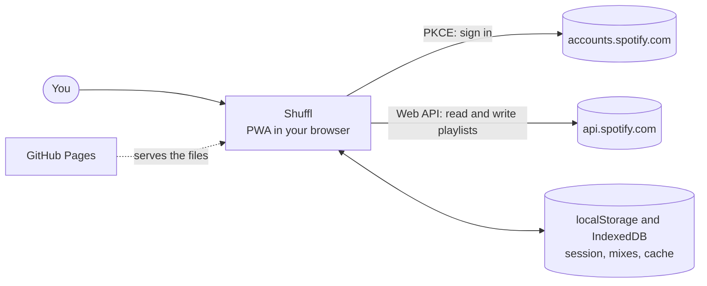

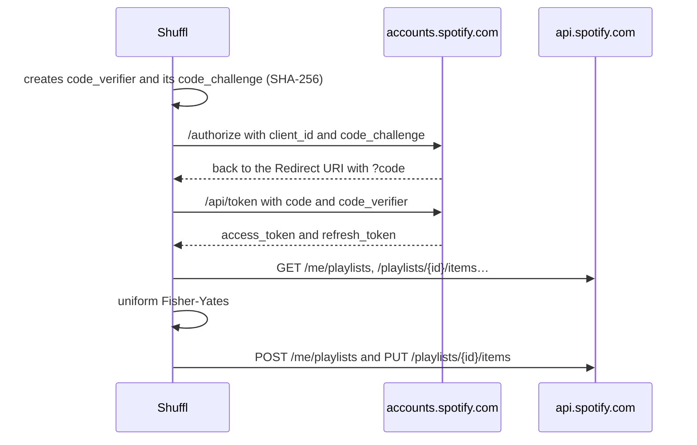

**Stack:** vanilla HTML, CSS and JavaScript with native ES modules. No build step, no frameworks and no runtime dependencies. A service worker makes it installable and lets it open offline, and GitHub Pages deploys each version once CI passes. It has 150+ unit tests (`node --test`) and about 170 end-to-end tests with Playwright against a simulated Spotify.

## FAQ

<b>Why do I need my own Client ID?</b>

Spotify limits each app in Development Mode to 5 users that the owner adds by hand. A shared app would be full with 5 people. With your own Client ID you decide who uses it, and Shuffl needs no server.

<b>Does it delete my playlists?</b>

No. Shuffl creates a new playlist, such as "Rock · Shuffl", and your original playlist stays as it was. To keep your library tidy, before creating another one it removes the previous one of the same kind it created, and only that one: a new shuffle replaces the previous shuffle and a new Explore the previous Explore, but your shuffle and your Explore stay side by side (the same for New releases, Forgotten and Snapshots). It never removes one of yours, a renamed one or someone else's. The first time it shows you the list and asks. Removed playlists can be recovered for 90 days at spotify.com → Account → Recover playlists. If you choose “Shuffle my original playlist”, it only changes the order of that playlist, removes nothing, asks the first time and you can Undo.

<b>Is it safe?</b>

The code is open and can be reviewed in full. There is no server storing anything; sign-in uses PKCE (the standard for apps without a secret) and tokens stay in your browser. The app asks only for the permissions it uses and never inserts Spotify data into the page as HTML. Every release goes through a security review; if you find a problem, see [SECURITY.md](SECURITY.md).

<b>Does it work without Premium?</b>

The account that creates the Client ID needs Premium: that is Spotify's rule for apps in Development Mode. "Play now" needs it too. If you just want to see what it is like, the demo needs nothing.

<b>How is it different from Spotify's shuffle?</b>

It depends on what you want. According to Spotify, its default shuffle [takes your recent listening into account](https://newsroom.spotify.com/2025-11-13/shuffle-update-fewer-repeats/) so that songs repeat less. Shuffl does something else: it does not look at your history and gives every song the same chance. It leaves the playlist in that order and Spotify plays it as is, with its own shuffle off.

<b>What does Shuffl see in my account?</b>

Just what each feature needs: your playlists, Liked Songs, followed artists, your top and your recent plays (for Discover and Your summary), and the player for "Play now". Nothing leaves your device except the requests to Spotify.

<b>Does it work on iPhone?</b>

Yes. It is a PWA: add it to the Home Screen from Safari and it opens like an app. Siri shortcuts work with one link per mix; CarPlay does not support web apps.

<b>Can my family use it?</b>

Yes, up to 5 people per Client ID: add their emails in User Management. Each person signs in with their own Spotify account.

<b>It says "Spotify limits how many searches…". What now?</b>

That is Spotify's quota for your Client ID. Wait a while; meanwhile you can keep shuffling playlists already read, which are kept on the device. More → Diagnostics shows how many requests each action used.

<b>Can I run my own copy?</b>

Yes. Fork it, turn on GitHub Pages with "GitHub Actions" as the source and add your address as a Redirect URI. Optionally, put your Client ID in `js/config.js`. The steps are in [CONTRIBUTING.md](CONTRIBUTING.md).

## Roadmap

The next ideas are in [ROADMAP.md](ROADMAP.md) and the [issues](https://github.com/JuandelMazoVazquez/shuffl/issues). New proposals go to [Discussions → Ideas](https://github.com/JuandelMazoVazquez/shuffl/discussions/categories/ideas).

## Contributing

Welcome! Issues labelled [`good first issue`](https://github.com/JuandelMazoVazquez/shuffl/labels/good%20first%20issue) are a good place to start, and you do not need a Spotify account: with `npm run dev` and the demo you can try everything. How to get started, the tests and the style are in [CONTRIBUTING.md](CONTRIBUTING.md). There is a [code of conduct](CODE_OF_CONDUCT.md).

## Credits

Built with Claude agents (Anthropic), with decisions and reviews documented in [DECISIONES.md](DECISIONES.md) and [docs/registro](docs/registro) (in Spanish). The covers, songs and artists in the demo and the screenshots are made up and generated by the app itself.

## License and notice

[MIT](LICENSE). Shuffl is an independent project, **not affiliated with or endorsed by Spotify**. Spotify is a trademark of Spotify AB; its logo (`icons/spotify/`) is used unmodified under its developer branding guidelines.
