# Shuffl

[Español](README.md)

Shuffl is a static PWA (vanilla HTML, CSS and JavaScript, no build step and no runtime dependencies) that truly shuffles your Spotify playlists.

Independent project, not affiliated with or endorsed by Spotify. Spotify is a trademark of Spotify AB; its logo (`icons/spotify/`) is included unmodified under its developer branding guidelines.

## Why it exists

Spotify's shuffle is not uniform: users with 1,500 songs report hearing the same 30 over and over, and Spotify added "Fewer Repeats" to make it repeat less. Shuffl does not touch the player. It rewrites the saved order of the playlist:

- Fisher-Yates with `crypto.getRandomValues` and rejection sampling (no modulo bias), in `js/core.js`.
- Every song has the same probability of landing in any position. No weights, no artist rules, no excluding recent listens.
- The result is a playlist you play **in order**, with Spotify's shuffle turned off.

The features come from real user complaints (Spotify Community threads, press, reviews). The sources, including what could and could not be verified, are in [INVESTIGACION.md](INVESTIGACION.md) (in Spanish).

## Features

The app interface is available in Spanish and English; the screenshots are in Spanish.

### Home and look

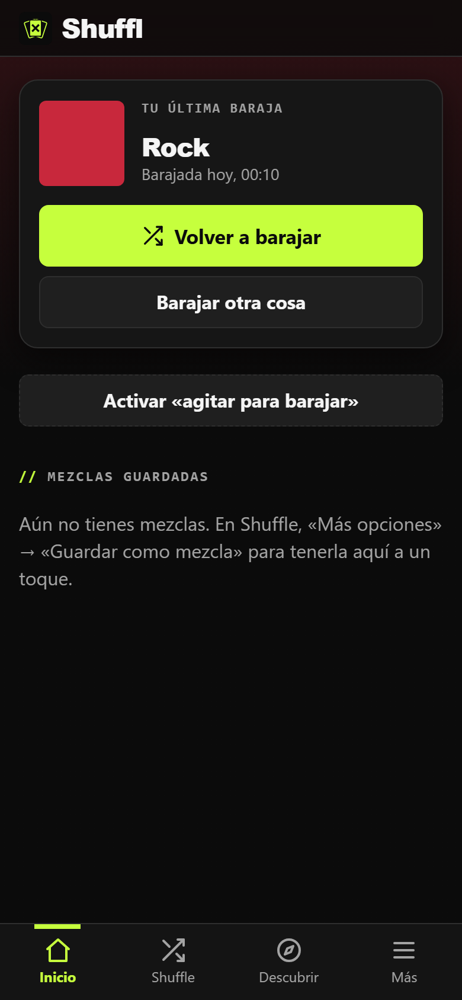

- Four tabs: **Home · Shuffle · Discover · More**. More holds Sort, Duplicates, Backup, Snapshots, Liked without playlist, Split, "Keep it at hand", "Is it really random?" and Settings.
- Home shows a card with your last shuffle (cover, name and date) and "Shuffle again"; the first time, "Get started". Below, "Recent" and your saved mixes.
- Black and lime green. Dark theme by default, light (white with dark green) or like the system, in Settings. The background takes a subtle gradient from the selected cover's colour.
- Instant screen changes with a short fade and no jumps (each tab remembers where you left it), a "Shuffling…" screen with cards shuffling and the real step, cascading results with a discreet celebration, loading skeletons, swipe sideways to change tab and pull down to refresh. With "reduce motion" there are no animations.
- **Shake to shuffle**: on Home, shaking the phone reshuffles the last mix, always after confirming. On iPhone it has to be turned on with a tap (motion sensor permission); it can be switched off in Settings.

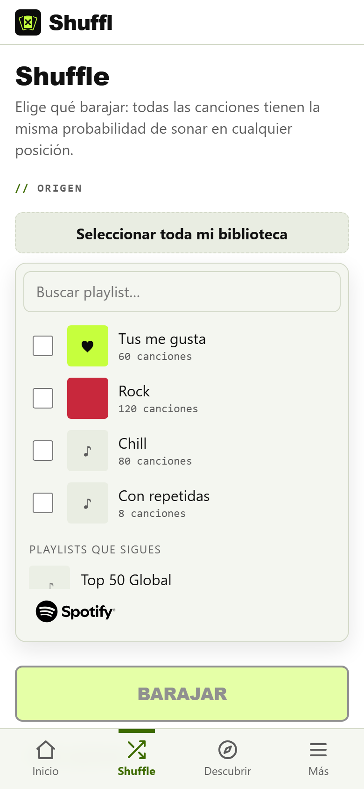

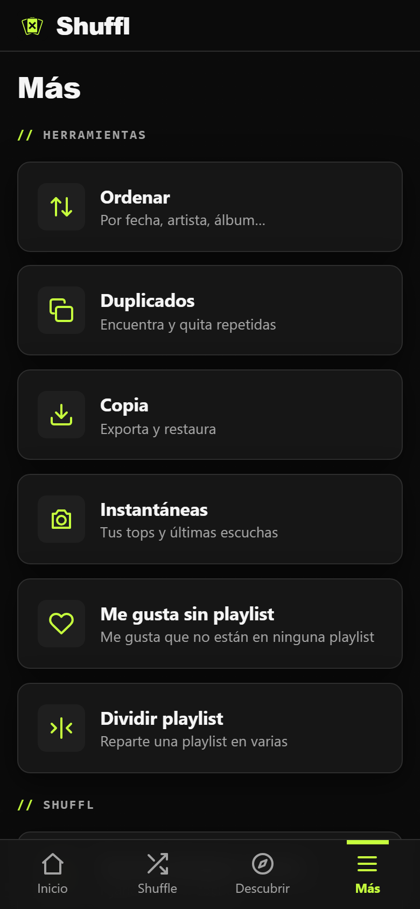

### Shuffle

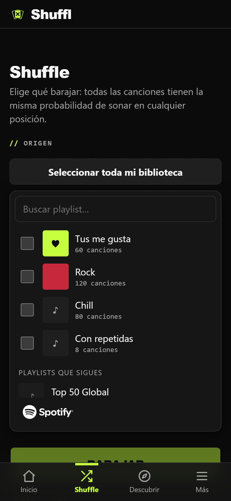

- One mode, by songs. "More options" holds **By time**: 15, 30, 45, 60 min or any length; it shuffles uniformly and fills the time within ±2 min ("35 min · Shuffle"), for your commute, workout or run.
- Remove repeats, filters, destination, paste a link and save as mix are also under "More options"; it works well without touching them.

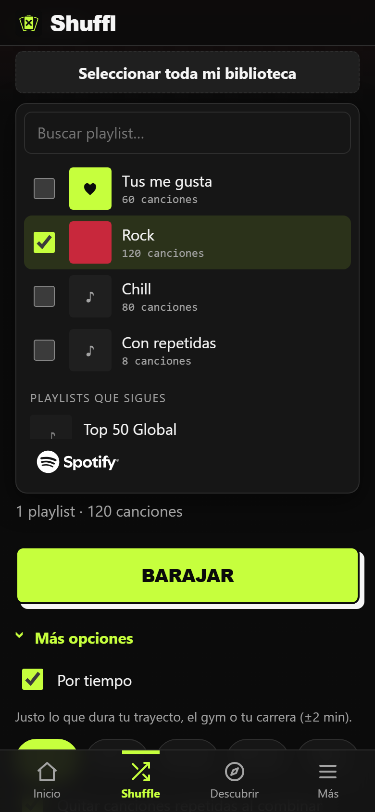

- Pick one or several playlists and Liked Songs: they are combined and shuffled together. By default it removes repeated songs (same URI) when combining. Optional filters (year, date added, length, explicit) are applied first; whatever is left is shuffled uniformly.
- Destination:
  - A new Shuffl playlist (default): "Reggaeton · Shuffle", "Liked Songs · Shuffle", "Mix · Shuffle" (several playlists; the description lists them), "Car · Shuffle" (saved mix) or "All my music · Shuffle". It replaces the previous Shuffl one (see below).
  - The playlist itself, only for one of your own playlists and with confirmation.
- The generated playlist's cover shows the Shuffl icon, the source name and the date (can be turned off in Settings).
- The result shows the name, songs and length, with "▶ Play now" (Premium) and "Open in Spotify", and the song list with each album cover. You can also shuffle again, share it or press Undo.

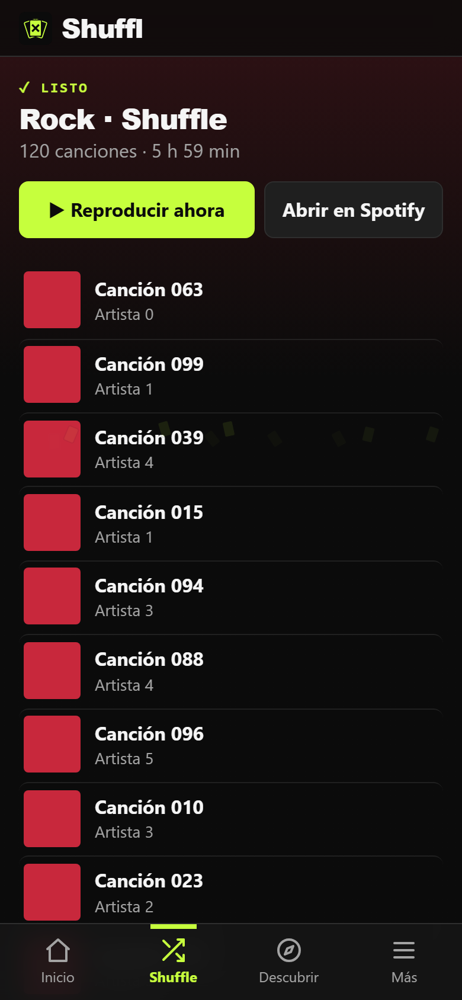

### Only one Shuffl playlist in your account

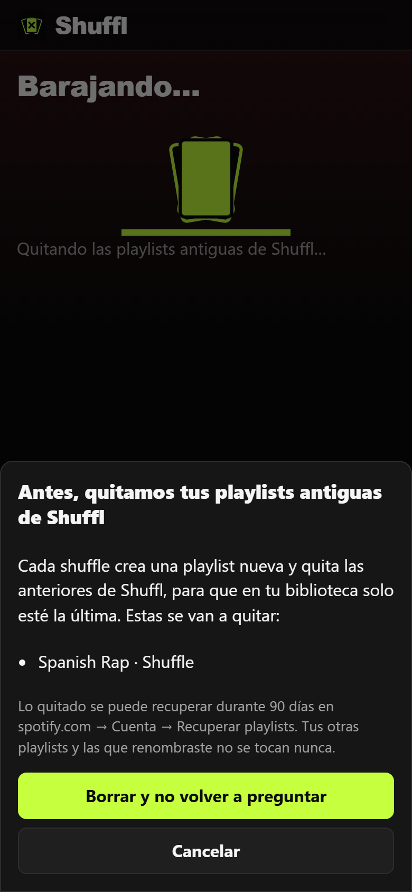

- Every time Shuffl is about to create a playlist (shuffle, Discover, Forgotten, Snapshots, My top), it first reads the songs, then removes from your library every playlist it created before, and then creates the new one. So only one exists: the latest.
- Shuffl playlists are your own ones with its tag in the description (` · shuffl:src=<hash>`, no ids or names) or, from older versions, with a "… · Shuffle", "📸 …" or "🔀 Baraja" name and a description the app used to write. Renamed playlists, other people's, collaborative ones and those without that description are never touched, and they are not offered as a source.
- The first time it shows the list with "Remove and don't ask again"; after that it is automatic, with a notice. It can be turned off in Settings. Removed playlists can be recovered for 90 days on spotify.com → Account → Recover playlists.
- If removing or creating fails, you see Spotify's real error with "Retry" (the songs stay in memory). "Check connection" in Settings tests that Shuffl can remove playlists.
- Since every shuffle creates a new playlist, the pin in Your Library is not kept: sort Your Library by "Recents" to keep it at the top.

### Discover

Spotify no longer offers recommendations to apps like this one, so Shuffl finds them from what you play and follow. Each option creates a Shuffl playlist with a cover and "Play now".

- **New releases**: releases from the last 7, 30 or 90 days.
- **Explore**: songs from the albums you play and from your artists.
- In both: about 30 songs and "Find more" to add 30 more to the same playlist; under "More options", a number (15-100) or a length (30-90 min). They can be based on your artists, on one of your playlists ("Like my playlist…") or on a genre (if Spotify gives genres for your artists). They never include songs you already have in your playlists or Liked Songs.
- **Forgotten**: Liked Songs from over 1, 2, 3 or 5 years ago.
- **Your summary**: your top 5 artists and songs (4 weeks, 6 months or all time) on a vertical story card (1080×1920) and a square one, to share or download. Covers are shown whole with nothing on top, next to the Spotify logo. You can create "My top · Shuffle".

What is read from Spotify (artists, releases, album songs and which songs you have) is kept on the device for up to 24 h to use fewer requests.

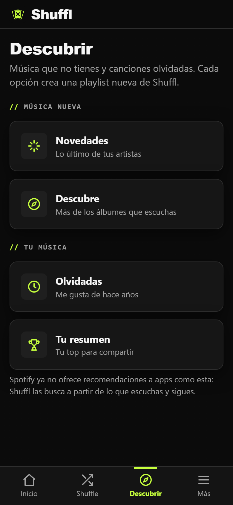

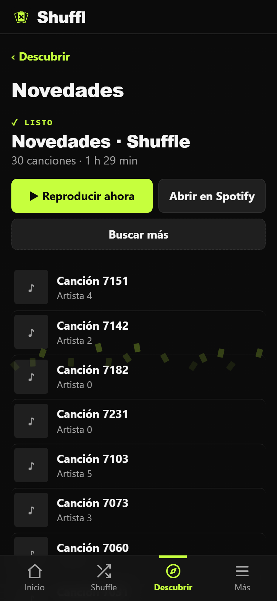

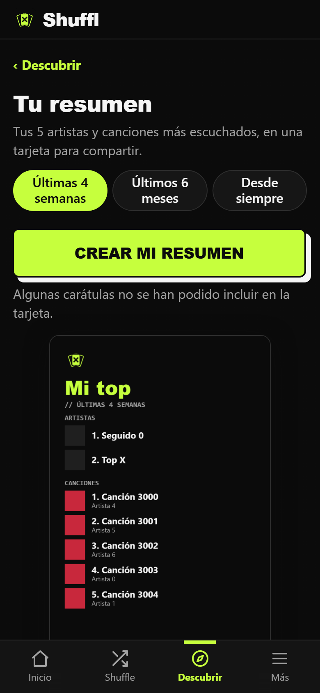

### Pick for me and "Is it really random?"

- **Pick for me**: a roulette picks one of your playlists, all with the same probability (the pick happens before the animation), and shuffles it into a new Shuffl playlist.
- **Is it really random?**: simulates 10,000 shuffles of 10 songs on your device and shows, with an animated bar chart and a table, how often each song plays first with the Shuffl shuffle (all close to 10%) and with a biased shuffle (the classic mistake of swapping each song with any position).

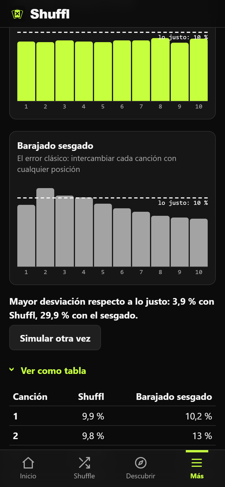

### Siri, shortcuts and the car

- Deep links: `?mezcla=<id>&play=1` reshuffles a saved mix and plays it with Spotify shuffle off; `?origen=<playlist id>&play=1` does the same for a playlist. They only run when signed in and if the mix or playlist exists in that browser, they always create a new Shuffl playlist (never write to the source) and they are removed from the address bar once read. Shortcuts carry a key for that browser (`k`); a link without it, for example from another website, asks for confirmation.
- Every saved mix has a "Create Siri shortcut" button with the link to copy and the steps in the Shortcuts app ("Open URLs" action and a name such as "Shuffl car"). On iPhone, Shortcuts opens the link in Safari, which does not share data with the Home Screen app: you need to sign in, have the mix and create the shortcut in Safari too.
- CarPlay does not support web apps. Your Shuffl playlist does show up in Spotify inside CarPlay; the "Keep it handy" help explains it.

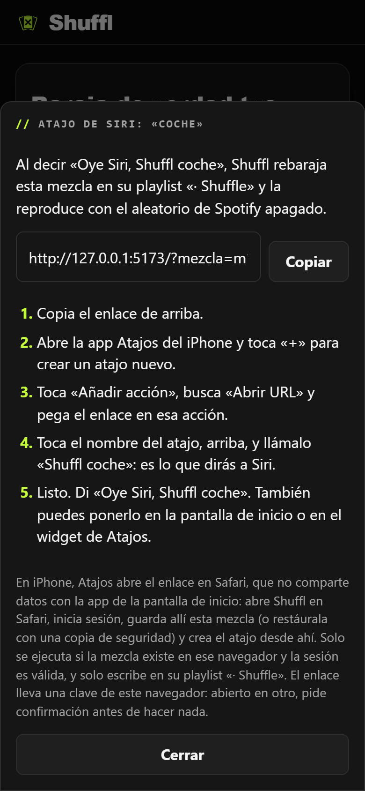

### Sort

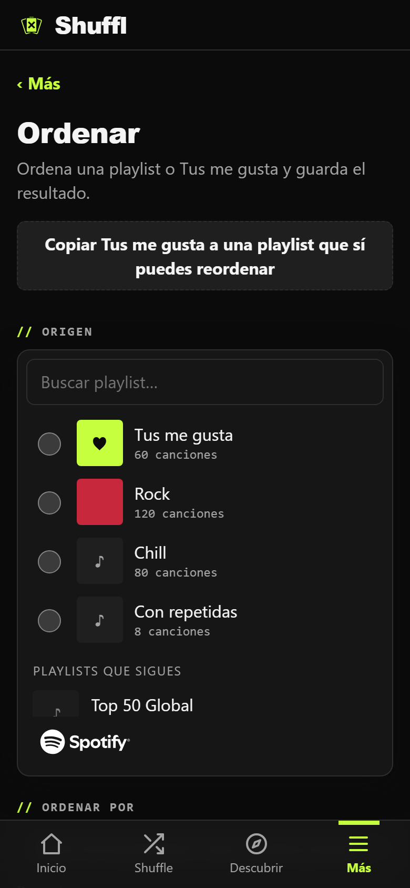

- Criteria: release date (ascending and descending), artist, album, title, duration (ascending and descending), date added (ascending and descending), reverse.
- Shortcut to copy Liked Songs into a regular playlist, which can be reordered.
- Filter by date added (from and to, both optional).
- Destination: a new playlist, or overwrite your own (not available with Liked Songs or with the date filter).

### Duplicates


- Exact: same URI.
- Smart: same ISRC, or same title and artist even on another release (remaster, radio edit). Live and Acoustic count as different versions.
- The first occurrence is kept. You choose which repeats to remove, and whether to do it in the original playlist (with Undo) or in a clean copy.

### Backup and restore


- Exports the chosen playlists (and Liked Songs) to JSON or CSV. On devices that support it, it uses the share sheet; otherwise it downloads the file.
- Restore reads a Shuffl JSON and creates one new playlist per entry, with the suffix "(restored)".

### Undo

Before overwriting a playlist, Shuffl stores the previous songs and order in the browser. Settings has an Undo button, and each result offers it for its playlist. Only one copy is kept: the latest operation that overwrites.

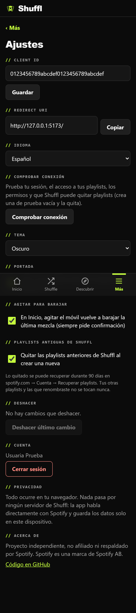

## First use: create your Client ID

There is no server, so each person uses their own Spotify Client ID.

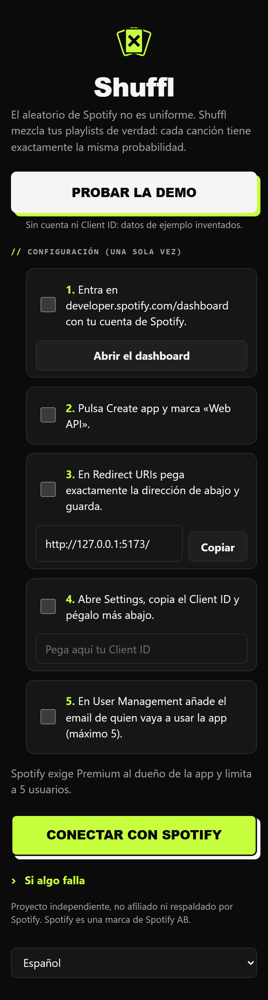

1. Go to [developer.spotify.com/dashboard](https://developer.spotify.com/dashboard) and sign in.
2. Click Create app and tick "Web API".
3. In Redirect URIs add the address Shuffl shows (see below) and save.
4. Open Settings, copy the Client ID and paste it into Shuffl.
5. In User Management add the email of everyone who will use the app (5 at most).

Spotify requirements for Development Mode apps: the app owner needs Premium and the app admits up to 5 users.

### Redirect URI

Shuffl uses `new URL('./', location.href)`, so the URI is the app address with a trailing slash:

- Local: `http://127.0.0.1:5173/` (`localhost` is not accepted).
- GitHub Pages: `https://USER.github.io/new-spoti/`.

Settings and the start screen show the exact URI with a copy button.

## Install on iPhone

Open the app's HTTPS address in Safari, tap Share and choose Add to Home Screen. It needs HTTPS, so it does not work with the local version.

## Fork and deploy to GitHub Pages

1. Fork the repository.
2. In Settings, Pages, set the source to "GitHub Actions".
3. The `.github/workflows/pages.yml` workflow publishes the app on every push to `main` (only if the repo is public) or manually with "Run workflow".
4. Optional: put your Client ID in `DEFAULT_CLIENT_ID` in `js/config.js`. The Client ID is not secret (PKCE uses no client secret), but each app admits at most 5 users.
5. Add the Redirect URI `https://USER.github.io/new-spoti/` to your Spotify app.

## Limitations

- With the API used, Spotify only lets you read your own or collaborative playlists: the others appear disabled.
- Local files are skipped (Shuffl reports how many). Overwriting a playlist that contains local files loses them, which is why it asks for confirmation.
- At most 10,000 songs per playlist: the rest is cut after shuffling.
- Liked Songs may be unavailable (it is probed when the app opens and marked unavailable if it fails).
- Undo keeps a single operation.
- Development Mode: Premium for the owner and 5 users.

## Development

Requires Node.js.

```
npm run dev        # static server at http://127.0.0.1:5173
npm test           # unit tests (node --test)
npm run test:e2e   # end-to-end tests with Playwright
npm run icons      # regenerates the icons in icons/
```

`npm install` only installs Playwright (a devDependency). See [CONTRIBUTING.md](CONTRIBUTING.md).

## Privacy

Everything happens in your browser. Shuffl only talks to `accounts.spotify.com` and `api.spotify.com`, with no server of its own, analytics or cookies. Details in [PRIVACY.md](PRIVACY.md).

## License

MIT, see [LICENSE](LICENSE).
