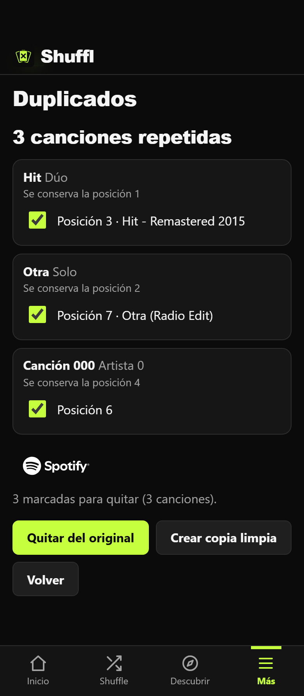
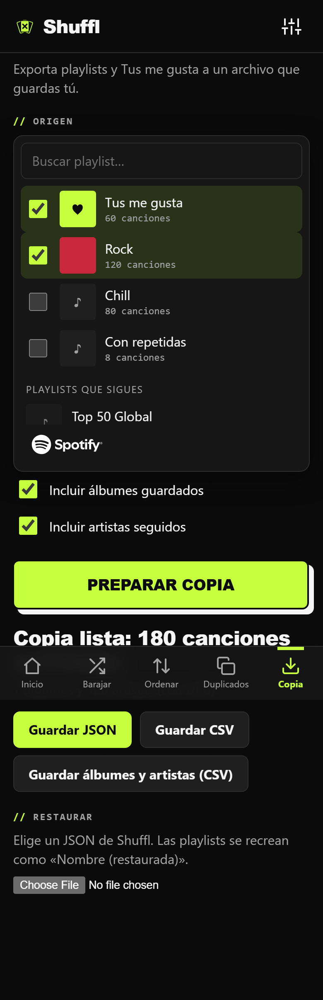

# Baraja

[Español](README.md)

Baraja is a static PWA (vanilla HTML, CSS and JavaScript, no build step and no runtime dependencies) that truly shuffles your Spotify playlists.

Independent project, not affiliated with or endorsed by Spotify. Spotify is a trademark of Spotify AB.

## Why it exists

Spotify's shuffle is not uniform: users with 1,500 songs report hearing the same 30 over and over, and Spotify added "Fewer Repeats" to make it repeat less. Baraja does not touch the player. It rewrites the saved order of the playlist:

- Fisher-Yates with `crypto.getRandomValues` and rejection sampling (no modulo bias), in `js/core.js`.
- Every song has the same probability of landing in any position. No weights, no artist rules, no excluding recent listens.
- The result is a playlist you play **in order**, with Spotify's shuffle turned off.

The features come from real user complaints (Spotify Community threads, press, reviews). The sources, including what could and could not be verified, are in [INVESTIGACION.md](INVESTIGACION.md) (in Spanish).

## Features

The app interface is available in Spanish and English; the screenshots are in Spanish.

### Shuffle


- Pick one or several playlists and Liked Songs: they are combined and shuffled together. By default it removes repeated songs (same URI) when combining.
- Destination:
  - "🔀 Baraja" playlist: created once and overwritten on every shuffle.
  - A new playlist on every shuffle (`Baraja · date`).
  - The playlist itself, only for one of your own playlists and with confirmation.
- After shuffling you can shuffle again, open the playlist in Spotify or press Undo.


### Sort


- Criteria: release date (ascending and descending), artist, album, title, duration (ascending and descending), date added (ascending and descending), reverse.
- Shortcut to copy Liked Songs into a regular playlist, which can be reordered.
- Filter by date added (from and to, both optional).
- Destination: a new playlist, or overwrite your own (not available with Liked Songs or with the date filter).

### Duplicates



- Exact: same URI.
- Smart: same ISRC, or same title and artist even on another release (remaster, radio edit). Live and Acoustic count as different versions.
- The first occurrence is kept. You choose which repeats to remove, and whether to do it in the original playlist (with Undo) or in a clean copy.

### Backup and restore



- Exports the chosen playlists (and Liked Songs) to JSON or CSV. On devices that support it, it uses the share sheet; otherwise it downloads the file.
- Restore reads a Baraja JSON and creates one new playlist per entry, with the suffix "(restored)".

### Undo

Before overwriting a playlist, Baraja stores the previous songs and order in the browser. Settings has an Undo button, and each result offers it for its playlist. Only one copy is kept: the latest operation that overwrites.


## First use: create your Client ID

There is no server, so each person uses their own Spotify Client ID.


1. Go to [developer.spotify.com/dashboard](https://developer.spotify.com/dashboard) and sign in.
2. Click Create app and tick "Web API".
3. In Redirect URIs add the address Baraja shows (see below) and save.
4. Open Settings, copy the Client ID and paste it into Baraja.
5. In User Management add the email of everyone who will use the app (5 at most).

Spotify requirements for Development Mode apps: the app owner needs Premium and the app admits up to 5 users.

### Redirect URI

Baraja uses `new URL('./', location.href)`, so the URI is the app address with a trailing slash:

- Local: `http://127.0.0.1:5173/` (`localhost` is not accepted).
- GitHub Pages: `https://USER.github.io/new-spoti/`.

Settings and the start screen show the exact URI with a copy button.

## Install on iPhone

Open the app's HTTPS address in Safari, tap Share and choose Add to Home Screen. It needs HTTPS, so it does not work with the local version.

## Fork and deploy to GitHub Pages

1. Fork the repository.
2. In Settings, Pages, set the source to "GitHub Actions".
3. The `.github/workflows/pages.yml` workflow publishes the app on every push to `main` (only if the repo is public) or manually with "Run workflow".
4. Optional: put your Client ID in `DEFAULT_CLIENT_ID` in `js/config.js`. The Client ID is not secret (PKCE uses no client secret), but each app admits at most 5 users.
5. Add the Redirect URI `https://USER.github.io/new-spoti/` to your Spotify app.

## Limitations

- With the API used, Spotify only lets you read your own or collaborative playlists: the others appear disabled.
- Local files are skipped (Baraja reports how many). Overwriting a playlist that contains local files loses them, which is why it asks for confirmation.
- At most 10,000 songs per playlist: the rest is cut after shuffling.
- Liked Songs may be unavailable (it is probed when the app opens and marked unavailable if it fails).
- Undo keeps a single operation.
- Development Mode: Premium for the owner and 5 users.

## Development

Requires Node.js.

```
npm run dev        # static server at http://127.0.0.1:5173
npm test           # unit tests (node --test)
npm run test:e2e   # end-to-end tests with Playwright
npm run icons      # regenerates the icons in icons/
```

`npm install` only installs Playwright (a devDependency). See [CONTRIBUTING.md](CONTRIBUTING.md).

## Privacy

Everything happens in your browser. Baraja only talks to `accounts.spotify.com` and `api.spotify.com`, with no server of its own, analytics or cookies. Details in [PRIVACY.md](PRIVACY.md).

## License

MIT, see [LICENSE](LICENSE).
