**Español** · [English](README.en.md)

<p align="center">
  <a href="https://juandelmazovazquez.github.io/new-spoti/?demo=1">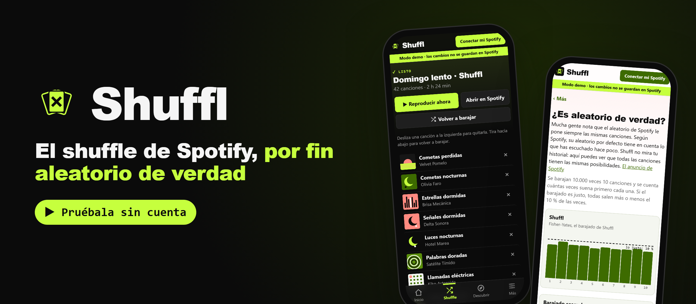</a>
</p>

<h1 align="center">Shuffl</h1>

<p align="center"><b>El shuffle de Spotify, por fin aleatorio de verdad.</b><br>
Una web app libre y gratuita que baraja tus playlists con un Fisher-Yates uniforme. Sin servidor, sin cuentas nuevas y sin analítica.</p>

<p align="center">
  <a href="https://github.com/JuandelMazoVazquez/new-spoti/actions/workflows/ci.yml"></a>
  <a href="LICENSE"></a>
  <a href="https://github.com/JuandelMazoVazquez/new-spoti/releases/latest"></a>
  <a href="https://juandelmazovazquez.github.io/new-spoti/?demo=1"></a>
</p>

<p align="center">
  <a href="https://juandelmazovazquez.github.io/new-spoti/?demo=1"></a>
  &nbsp;
  <a href="#empezar-en-5-minutos"></a>
</p>

<p align="center">
  
</p>

## El problema

¿Tienes una playlist de 1.500 canciones y siempre suenan las mismas 30? No eres la única persona. El aleatorio de Spotify no es una baraja que puedas comprobar. «Fewer Repeats» favorece a propósito lo que has escuchado menos y Smart Shuffle mete recomendaciones entre tus canciones.

Shuffl no toca el reproductor: **reescribe el orden de la playlist** con un Fisher-Yates y `crypto.getRandomValues` (sin sesgo de módulo), y Spotify la reproduce **en orden**. Todas las canciones tienen la misma probabilidad de caer en cualquier posición, y la app te deja comprobarlo:

<p align="center">
  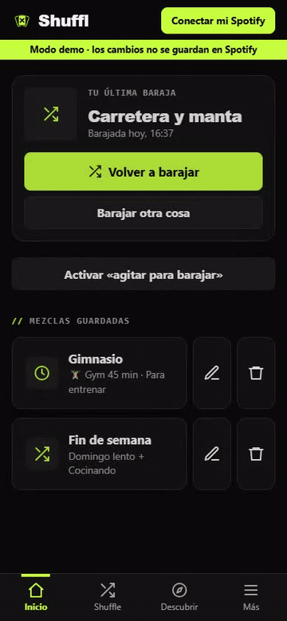
</p>

## Funciones

<table>
  <tr>
    <td align="center" width="25%">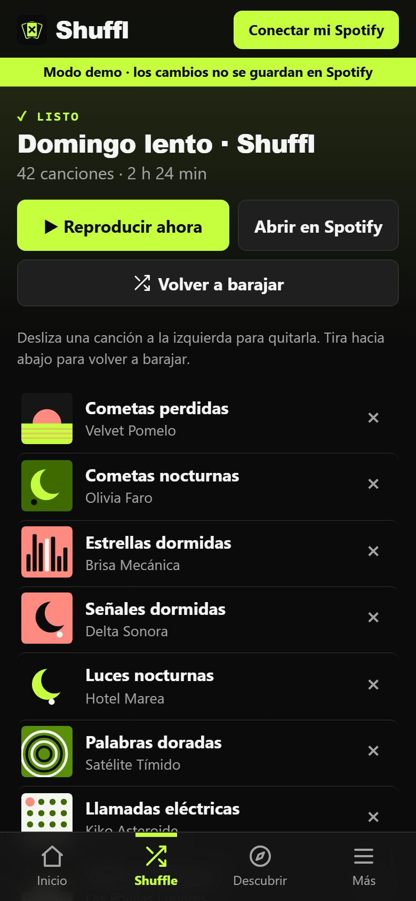<br><b>Barajar de verdad</b><br>Una o varias playlists y Tus me gusta, con filtros y sin repetidas.</td>
    <td align="center" width="25%">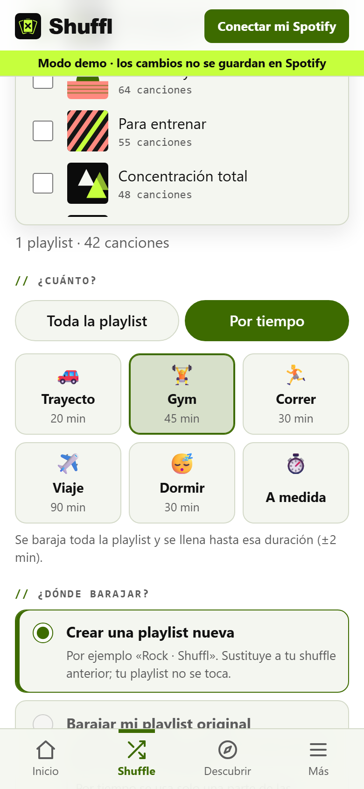<br><b>Por tiempo</b><br>Gym 45 min, Trayecto 20 o a medida de 5 a 180 min.</td>
    <td align="center" width="25%">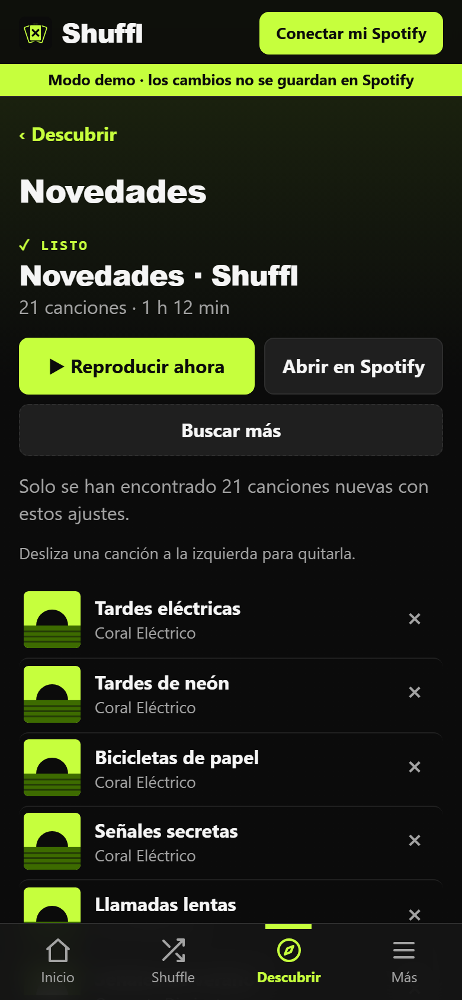<br><b>Novedades y Descubre</b><br>Lanzamientos de tus artistas y canciones que aún no tienes.</td>
    <td align="center" width="25%">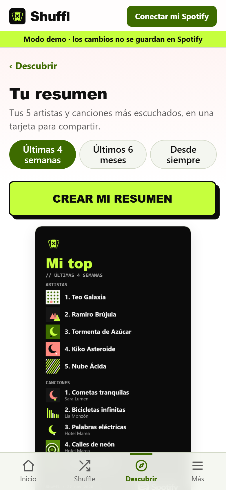<br><b>Tu resumen</b><br>Tu top en una tarjeta para compartir.</td>
  </tr>
  <tr>
    <td align="center">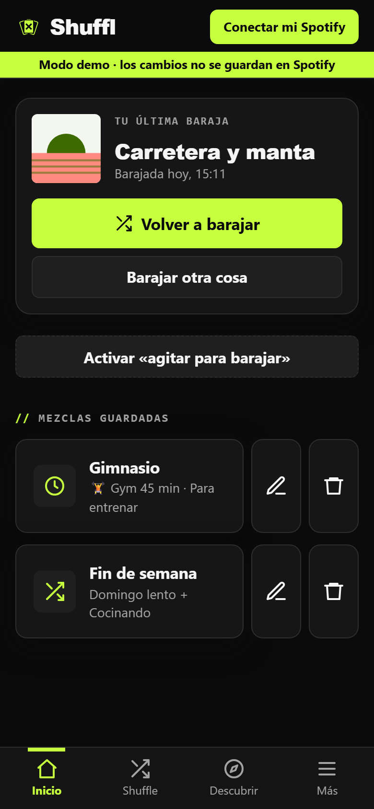<br><b>Un toque</b><br>Volver a barajar, mezclas guardadas, atajos de Siri y agitar el móvil.</td>
    <td align="center">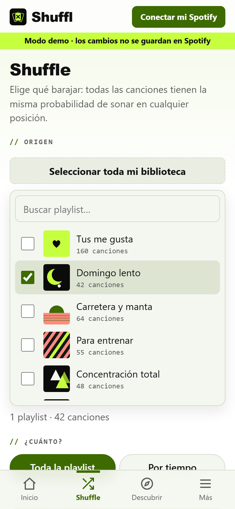<br><b>Reproducir ahora</b><br>La pone en tu Spotify con el aleatorio apagado y comprueba que suena.</td>
    <td align="center">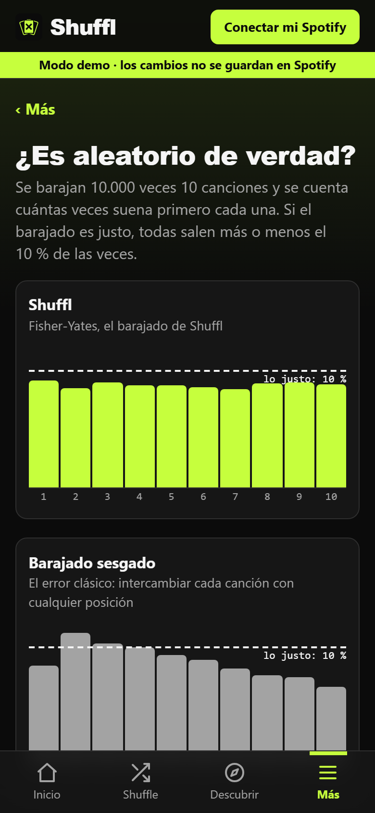<br><b>¿Es aleatorio?</b><br>10.000 barajas simuladas en tu móvil, con gráfico y tabla.</td>
    <td align="center">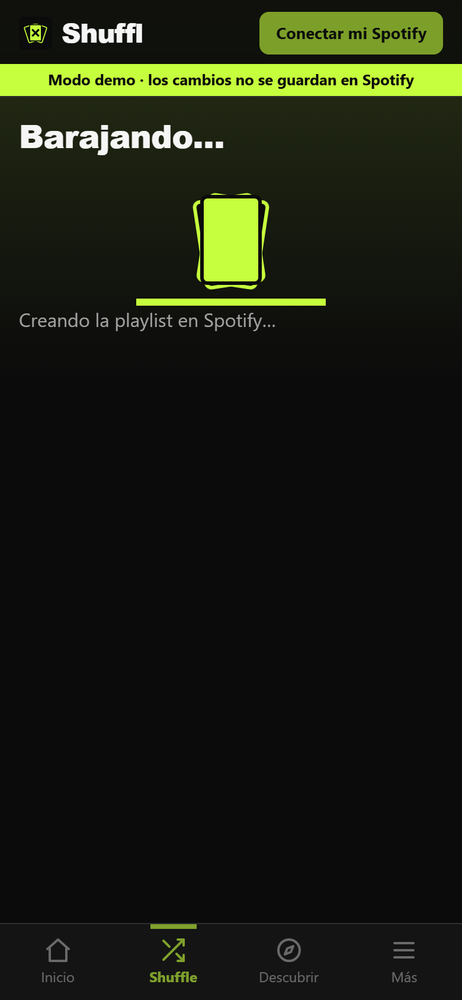<br><b>Y más herramientas</b><br>Ordenar, duplicados, copia de seguridad, dividir, instantáneas y Deshacer.</td>
  </tr>
</table>

Cada función en detalle: [docs/FUNCIONES.md](docs/FUNCIONES.md). Tema oscuro y claro, en español y en inglés.

<p align="center">
  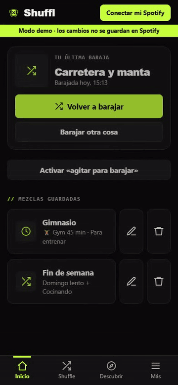
</p>

## Empezar en 5 minutos

**¿Solo quieres verla?** Abre la [demo](https://juandelmazovazquez.github.io/new-spoti/?demo=1): datos inventados, sin cuenta y sin tocar Spotify.

**Con tu Spotify.** Shuffl no tiene servidor, así que cada persona conecta su propia «app» de Spotify (un Client ID gratuito):

1. Entra en el [dashboard de Spotify for Developers](https://developer.spotify.com/dashboard) con tu cuenta y pulsa **Create app**.
2. Pon cualquier nombre y descripción, marca **Web API** y, en **Redirect URIs**, pega exactamente esta dirección (con la barra final):
   ```
   https://juandelmazovazquez.github.io/new-spoti/
   ```
3. Guarda, abre **Settings** y copia el **Client ID**.
4. En **User Management**, añade el nombre y el email de la cuenta de Spotify de cada persona que vaya a usarla (como máximo 5).
5. Abre [Shuffl](https://juandelmazovazquez.github.io/new-spoti/), pega el Client ID y pulsa **Conectar con Spotify**.

**Instalarla como app:**

| Dispositivo | Cómo |
|---|---|
| iPhone y iPad | Abre la dirección en **Safari** → botón Compartir → **Añadir a pantalla de inicio**. |
| Android | Abre la dirección en **Chrome** → menú ⋮ → **Instalar app** (o «Añadir a pantalla de inicio»). |
| PC y Mac | Funciona en cualquier navegador moderno. En Chrome o Edge, el icono de instalar de la barra de direcciones la abre en su propia ventana. |

Si algo falla al conectar, la pantalla de inicio tiene un apartado «Si algo falla» y, ya dentro, **Más → Diagnóstico** hace una prueba completa con tu cuenta.

## Requisitos y limitaciones

Spotify pone reglas a las apps como esta, y es mejor saberlas antes:

- **Spotify Premium** en la cuenta dueña del Client ID (regla de Spotify para apps en Development Mode). «Reproducir ahora» también necesita Premium.
- **5 usuarios por Client ID** como máximo, añadidos a mano en User Management. Por eso no hay un Client ID común: cada persona o familia crea el suyo.
- **Cuota de Spotify**: limita cuántas peticiones hace cada app. Shuffl guarda lo leído en el dispositivo y ninguna acción normal pasa de unas 40 peticiones; si se agota, lo explica y conserva lo conseguido.
- **Solo tus playlists o las colaborativas**: Spotify no deja leer el contenido de playlists de otras personas ni las suyas propias (las editoriales).
- **No hay CarPlay ni integración dentro de la app de Spotify**: CarPlay no admite apps web. La playlist que crea Shuffl sí aparece en Spotify, también en el coche.
- Los archivos locales se omiten, y una playlist admite hasta 10.000 canciones.

## Privacidad

Todo ocurre en tu dispositivo. Shuffl es una página estática: no tiene servidor, base de datos, analítica ni cookies, y solo habla con Spotify: `accounts.spotify.com`, `api.spotify.com` y su servidor de carátulas (`i.scdn.co`). Tu sesión, tus mezclas y la caché se quedan en tu navegador. El inicio de sesión usa PKCE, así que no hay ninguna contraseña ni secreto en el código. Detalle en [PRIVACY.md](PRIVACY.md).

## Cómo funciona por dentro

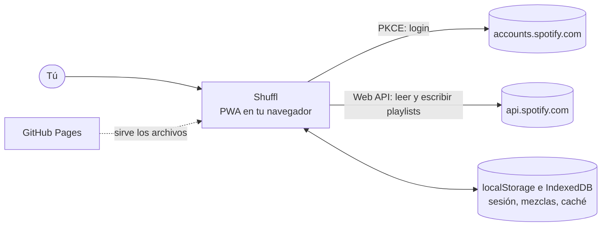

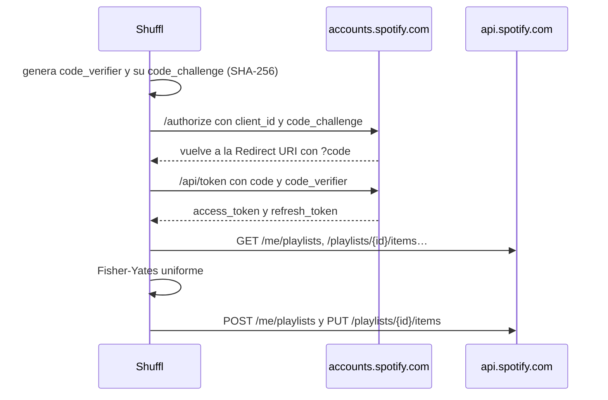

**Stack:** HTML, CSS y JavaScript vanilla con ES modules nativos. Sin build, sin frameworks y sin dependencias en tiempo de ejecución. Un service worker la hace instalable y la deja abrir sin conexión, y GitHub Pages despliega cada versión cuando el CI pasa. Hay más de 150 tests unitarios (`node --test`) y unos 170 de extremo a extremo con Playwright contra un Spotify simulado.

## Preguntas frecuentes

<details><summary><b>¿Por qué necesito mi propio Client ID?</b></summary>

Spotify limita cada app en Development Mode a 5 usuarios que el dueño añade a mano. Una app compartida se llenaría con 5 personas. Con tu propio Client ID, tú controlas quién la usa, y Shuffl no necesita servidor.
</details>

<details><summary><b>¿Borra mis playlists?</b></summary>

No. Shuffl crea una playlist nueva, por ejemplo «Rock · Shuffle», y tu playlist original queda igual. Para no llenar tu biblioteca, antes de crear otra quita la anterior que creó él, y solo esa: nunca una tuya, una renombrada ni una de otra persona. La primera vez te enseña la lista y te pregunta. Lo quitado se recupera durante 90 días en spotify.com → Cuenta → Recuperar playlists. Si eliges barajar la propia playlist, te lo confirma y puedes Deshacer.
</details>

<details><summary><b>¿Es seguro?</b></summary>

El código es abierto y se puede revisar entero. No hay servidor que guarde nada; el login usa PKCE (el estándar para apps sin secreto) y los tokens se quedan en tu navegador. La app pide solo los permisos que usa y nunca mete datos de Spotify en la página como HTML. Cada versión pasa una revisión de seguridad; si encuentras un problema, mira [SECURITY.md](SECURITY.md).
</details>

<details><summary><b>¿Funciona sin Premium?</b></summary>

La cuenta que crea el Client ID necesita Premium: es una regla de Spotify para las apps en Development Mode. «Reproducir ahora» también lo necesita. Si solo quieres ver cómo es, la demo no necesita nada.
</details>

<details><summary><b>¿Por qué no basta con el aleatorio de Spotify?</b></summary>

Porque no es una baraja uniforme que puedas comprobar: los modos «Fewer Repeats» y Smart Shuffle cambian lo que suena a propósito. Shuffl fija un orden uniforme en la playlist y Spotify la reproduce tal cual, con su aleatorio apagado.
</details>

<details><summary><b>¿Qué ve Shuffl de mi cuenta?</b></summary>

Lo justo para cada función: tus playlists, Tus me gusta, artistas que sigues, tu top y tus últimas escuchas (para Descubrir y Tu resumen), y el reproductor para «Reproducir ahora». Nada sale de tu dispositivo salvo las peticiones a Spotify.
</details>

<details><summary><b>¿Funciona en el iPhone?</b></summary>

Sí. Es una PWA: añádela a la pantalla de inicio desde Safari y se abre como una app. Los atajos de Siri funcionan con un enlace por mezcla; CarPlay no admite apps web.
</details>

<details><summary><b>¿Puedo usarla con mi familia?</b></summary>

Sí, hasta 5 personas por Client ID: añade sus emails en User Management. Cada persona inicia sesión con su propia cuenta de Spotify.
</details>

<details><summary><b>Dice «Spotify limita cuántas búsquedas…». ¿Qué hago?</b></summary>

Es la cuota de Spotify para tu Client ID. Espera un rato; mientras tanto puedes seguir barajando las playlists ya leídas, que se guardan en el dispositivo. En Más → Diagnóstico ves cuántas peticiones lleva cada acción.
</details>

<details><summary><b>¿Puedo tener mi propia copia?</b></summary>

Sí. Haz un fork, activa GitHub Pages con «GitHub Actions» como origen y añade tu dirección como Redirect URI. Opcionalmente, pon tu Client ID en `js/config.js`. Los pasos están en [CONTRIBUTING.md](CONTRIBUTING.md).
</details>

## Hoja de ruta

Las próximas ideas están en [ROADMAP.md](ROADMAP.md) y en los [issues](https://github.com/JuandelMazoVazquez/new-spoti/issues). Las propuestas nuevas van a [Discussions → Ideas](https://github.com/JuandelMazoVazquez/new-spoti/discussions/categories/ideas).

## Contribuir

¡Bienvenidas! Los issues marcados como [`good first issue`](https://github.com/JuandelMazoVazquez/new-spoti/labels/good%20first%20issue) son un buen punto de partida, y no hace falta cuenta de Spotify: con `npm run dev` y la demo puedes probarlo todo. Cómo arrancar, los tests y el estilo están en [CONTRIBUTING.md](CONTRIBUTING.md). Hay un [código de conducta](CODE_OF_CONDUCT.md).

## Créditos

Construido con agentes de Claude (Anthropic), con decisiones y revisiones documentadas en [DECISIONES.md](DECISIONES.md) y [docs/registro](docs/registro). Las carátulas, canciones y artistas de la demo y de las capturas son inventados y los genera la propia app.

## Licencia y aviso

[MIT](LICENSE). Shuffl es un proyecto independiente, **no afiliado ni respaldado por Spotify**. Spotify es una marca de Spotify AB; su logo (`icons/spotify/`) se usa sin modificar según sus normas de marca para desarrolladores.
