# Shuffl features in detail

[Español](FUNCIONES.md) · [Back to the README](../README.en.md)

The screenshots on this page come from the tests (simulated Spotify). The README ones come from the demo mode (`npm run media`).

The app interface is available in Spanish and English; the screenshots are in Spanish.

### Home and look

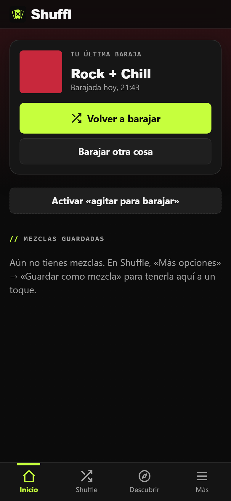

- Four tabs: **Home · Shuffle · Discover · More**. More holds Sort, Duplicates, Backup, Snapshots, Liked without playlist, Split, "Keep it at hand", "Is it really random?", Diagnostics and Settings.
- Home shows a card with your last shuffle (cover, name and date) and "Shuffle again"; the first time, "Get started". Below, "Recent" and your saved mixes.
- Black and lime green. Dark theme by default, light (white with dark green) or like the system, in Settings. The background takes a subtle gradient from the selected cover's colour.
- Instant screen changes with a short fade and no jumps (each tab remembers where you left it), a "Shuffling…" screen with cards shuffling and the real step, results with the covers dealt like cards and a discreet celebration, loading skeletons, swipe sideways to change tab and pull down to refresh. With "reduce motion" there are no animations.
- **Shake to shuffle**: on Home, shaking the phone reshuffles the last mix, always after confirming. On iPhone it has to be turned on with a tap (motion sensor permission); it can be switched off in Settings.

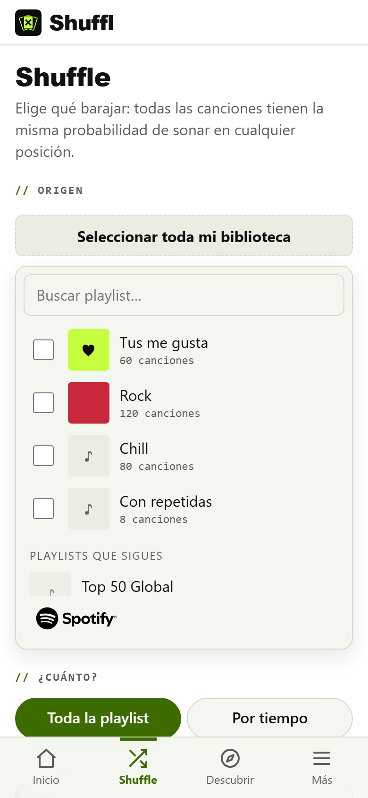

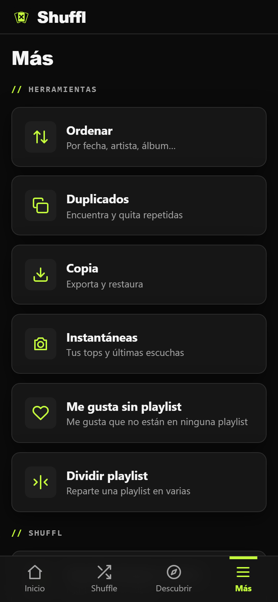

### Shuffle

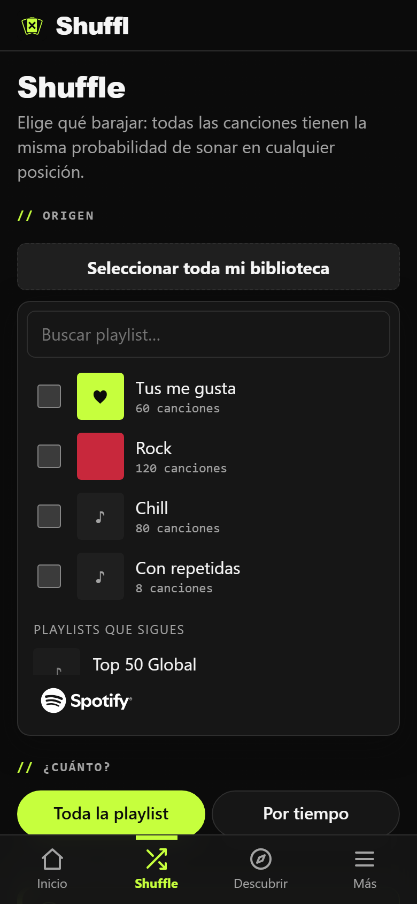

- Below the playlists you pick **Whole playlist** or **By time**. By time has quick picks (🚗 Commute 20 min, 🏋️ Gym 45, 🏃 Run 30, ✈️ Trip 90, 😴 Sleep 30) and "Custom", with a 5-180 min slider. It shuffles uniformly and fills the time within ±2 min: "Gym 45 min · Shuffl" or, custom, "Rock · 45 min · Shuffl". Saved mixes and Siri shortcuts remember the time.
- Next to the button you choose **where to shuffle**: "Create a new playlist" (default) or "Shuffle my original playlist". Your last choice is remembered.
- Remove repeats, filters, paste a link and save as mix are under "More options"; it works well without touching them.

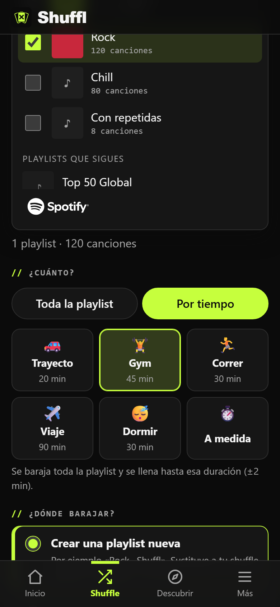

- Pick one or several playlists and Liked Songs: they are combined and shuffled together. By default it removes repeated songs (same URI) when combining. Optional filters (year, date added, length, explicit) are applied first; whatever is left is shuffled uniformly.
- Destination:
  - A new Shuffl playlist (default): "Reggaeton · Shuffl", "Liked Songs · Shuffl", "Mix · Shuffl" (several playlists; the description lists them), "Car · Shuffl" (saved mix) or "All my music · Shuffl". It replaces the previous Shuffl one (see below).
  - Shuffle my original playlist: changes the order of that playlist without creating another, removing songs or deleting anything. It asks the first time and Undo stays available. It works with a single playlist of your own or a collaborative one, whole; otherwise the option is disabled with the reason in one line: Liked Songs (Spotify does not allow reordering it), several playlists at once, by time or with filters.
- The generated playlist's cover shows the Shuffl icon, the source name and the date (can be turned off in Settings).
- The result shows the name, songs and length, with "▶ Play now" (Premium) and "Open in Spotify", and the song list with each album cover. Swipe a song left (or tap its ×) to remove it from the playlist; pull down or tap "Shuffle again" to reshuffle it right away. You can also share it or press Undo.
- "Play now" finds your Spotify, starts the playlist from the first song, turns shuffle off and checks that it really plays that way. If the phone is not active, it asks you to open Spotify for a moment; without Premium, on a device that cannot be controlled or if Spotify ignores the command, it explains and offers to open it in Spotify.

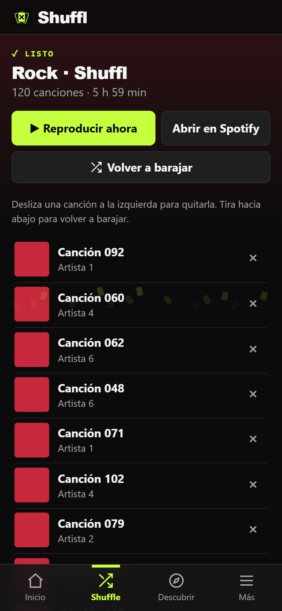

### One Shuffl playlist of each kind in your account

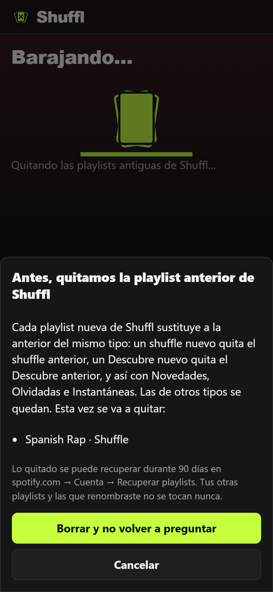

- Every time Shuffl is about to create a playlist, it first reads the songs, then removes from your library the one it created before **of the same kind**, and then creates the new one. The kinds are: shuffle (also by time and saved mixes), Explore, New releases, Forgotten, and Snapshots with My top. So your shuffle and your Explore stay side by side, and another shuffle only replaces the previous shuffle.
- The kind goes in the tag (` · shuffl:cat=<kind> · shuffl:src=<hash>`). Playlists created before v1.5.0 are classified by their source tag (a playlist of yours called "Explore" and shuffled is a shuffle); those without a tag are shuffles, except "📸 …", which are Snapshots.
- Shuffl playlists are your own ones with its tag in the description (` · shuffl:src=<hash>`, no ids or names) or, from older versions, with a "… · Shuffle", "📸 …" or first-version name and a description the app used to write. Renamed playlists, other people's, collaborative ones and those without that description are never touched, and they are not offered as a source.
- The first time it shows the list with "Remove and don't ask again"; after that it is automatic, with a notice. It can be turned off in Settings. Removed playlists can be recovered for 90 days on spotify.com → Account → Recover playlists.
- If removing or creating fails, it explains what happened with "Retry" (the songs stay in memory). "Check connection", in More → Diagnostics, tests that Shuffl can remove playlists.
- Since every shuffle creates a new playlist, the pin in Your Library is not kept: sort Your Library by "Recents" to keep it at the top, or shuffle your original playlist.

### Discover

Spotify no longer offers recommendations to apps like this one, so Shuffl finds them from what you play and follow. Each option creates a Shuffl playlist with a cover and "Play now".

- **New releases**: releases from the last 7, 30 or 90 days.
- **Explore**: songs from the albums you play and from your artists.
- In both: about 30 songs and "Find more" to add 30 more to the same playlist; under "More options", a number (15-100) or a length (30-90 min). They can be based on your artists, on one of your playlists or on Liked Songs ("Like my playlist…"; from Liked Songs it uses the 200 most recent) or on a genre (if Spotify gives genres for your artists). They never include songs you already have in your playlists or Liked Songs.
- Variety: at most 3 songs by the same artist (1, 2, 3 or 5 under "More options"), taking turns across all of them. If there are not enough different artists, it says so instead of filling up with the same one.
- **Forgotten**: 100 at random from your Liked Songs from over 1, 2, 3 or 5 years ago.
- **Your summary**: your top 5 artists and songs (4 weeks, 6 months or all time) on a vertical story card (1080×1920) and a square one, to share or download. Covers are shown whole with nothing on top, next to the Spotify logo. You can create "My top · Shuffl".

Spotify limits how many requests each app makes, so Shuffl saves them: each search stops after about 30 reads (under "More options" you choose how many artists it looks at each time), "Find more" continues where it left off and what is read is kept on the device (IndexedDB): your playlists' songs while they do not change, albums for 30 days, artists and releases for 24 h. To avoid suggesting what is already in your Liked Songs, it only asks about the candidate songs. If Spotify cuts off halfway, what was found is kept.

### Diagnostics

In More → Diagnostics: how many requests the session and the day have used (and each action), "Check connection", a **Full test** that, with your account, checks step by step signing in, reading, creating, overwriting and removing a test playlist, your devices and playback, and the log of the latest errors with "Copy report" (no names or tokens). No error is shown as a code: always a clear message with "Retry", "Connect again" or "Open in Spotify".

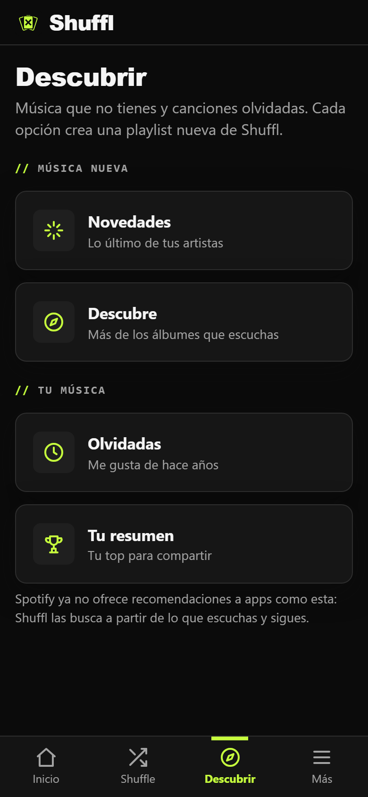

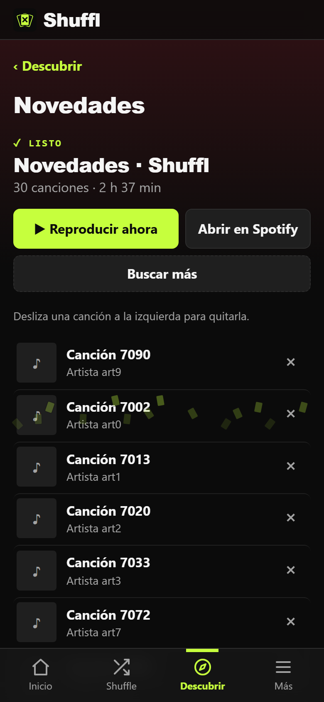

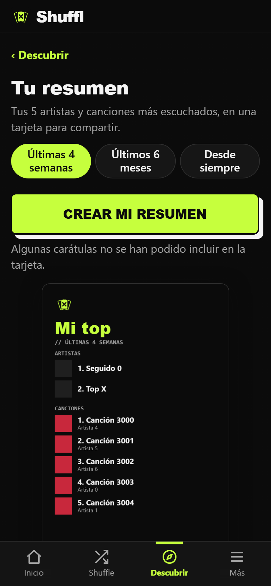

### Pick for me and "Is it really random?"

- **Pick for me**: a roulette picks one of your playlists, all with the same probability (the pick happens before the animation), and shuffles it into a new Shuffl playlist.
- **Is it really random?**: simulates 10,000 shuffles of 10 songs on your device and shows, with an animated bar chart and a table, how often each song plays first with the Shuffl shuffle (all close to 10%) and with a biased shuffle (the classic mistake of swapping each song with any position).

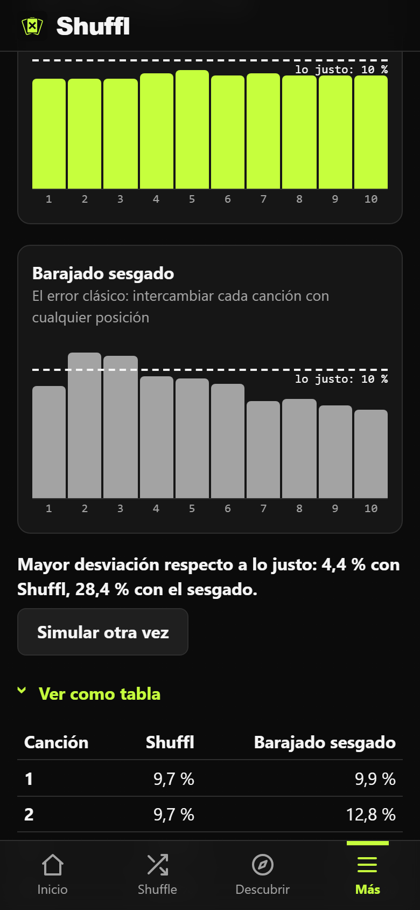

### Siri, shortcuts and the car

- Deep links: `?mezcla=<id>&play=1` reshuffles a saved mix and plays it with Spotify shuffle off; `?origen=<playlist id>&play=1` does the same for a playlist. They only run when signed in and if the mix or playlist exists in that browser, they always create a new Shuffl playlist (never write to the source) and they are removed from the address bar once read. Shortcuts carry a key for that browser (`k`); a link without it, for example from another website, asks for confirmation.
- Every saved mix has a "Create Siri shortcut" button with the link to copy and the steps in the Shortcuts app ("Open URLs" action and a name such as "Shuffl car"). On iPhone, Shortcuts opens the link in Safari, which does not share data with the Home Screen app: you need to sign in, have the mix and create the shortcut in Safari too.
- CarPlay does not support web apps. Your Shuffl playlist does show up in Spotify inside CarPlay; the "Keep it handy" help explains it.

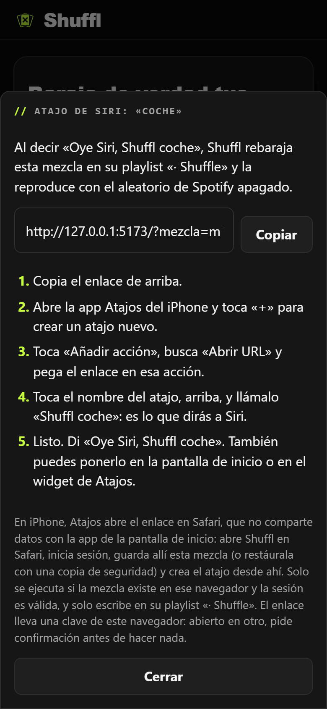

### Sort

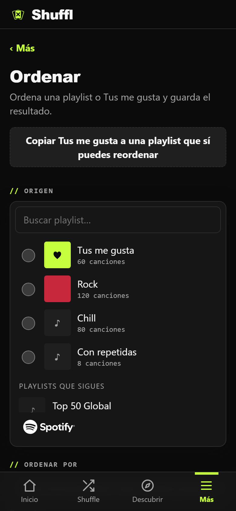

- Criteria: release date (ascending and descending), artist, album, title, duration (ascending and descending), date added (ascending and descending), reverse.
- Shortcut to copy Liked Songs into a regular playlist, which can be reordered.
- Filter by date added (from and to, both optional).
- Destination: a new playlist, or overwrite your own (not available with Liked Songs or with the date filter).

### Duplicates

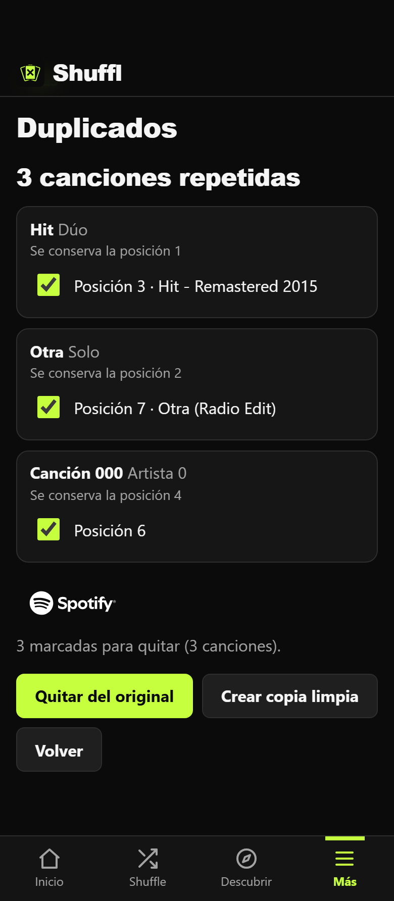

- Exact: same URI.
- Smart: same ISRC, or same title and artist even on another release (remaster, radio edit). Live and Acoustic count as different versions.
- The first occurrence is kept. You choose which repeats to remove, and whether to do it in the original playlist (with Undo) or in a clean copy.

### Backup and restore

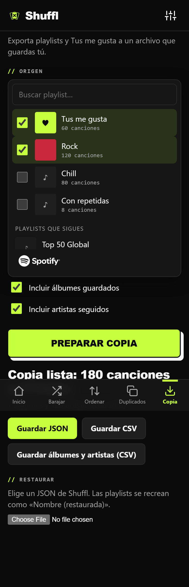

- Exports the chosen playlists (and Liked Songs) to JSON or CSV. On devices that support it, it uses the share sheet; otherwise it downloads the file.
- Restore reads a Shuffl JSON and creates one new playlist per entry, with the suffix "(restored)".

### Undo

Before overwriting a playlist, Shuffl stores the previous songs and order in the browser. Settings has an Undo button, and each result offers it for its playlist. Only one copy is kept: the latest operation that overwrites.

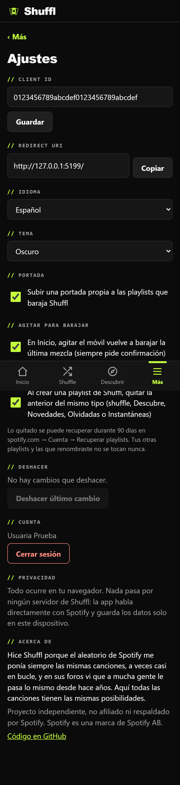
