# Funciones de Shuffl en detalle

[English](FEATURES.md) · [Volver al README](../README.md)

Las capturas de esta página salen de los tests (Spotify simulado). Las del README, del modo demo (`npm run media`).

### Inicio y aspecto

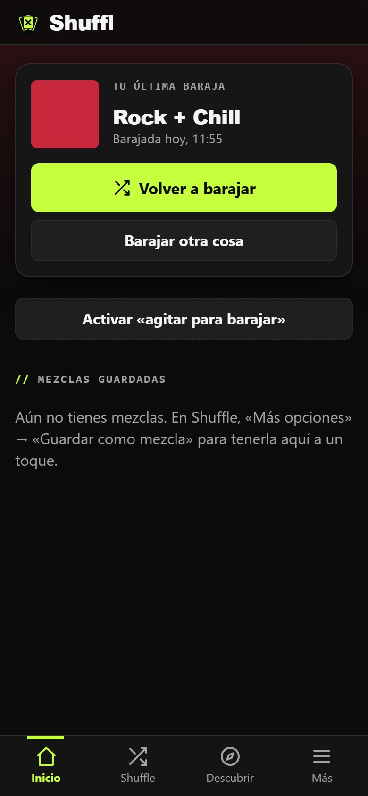

- Cuatro pestañas: **Inicio · Shuffle · Descubrir · Más**. En Más están Ordenar, Duplicados, Copia, Instantáneas, Me gusta sin playlist, Dividir, «Tenerla siempre a mano», «¿Es aleatorio de verdad?», Diagnóstico y Ajustes.
- Inicio tiene una tarjeta con tu última baraja (carátula, nombre y fecha) y «Volver a barajar»; la primera vez, «Empezar». Debajo, «Lo último» y tus mezclas guardadas.
- Negro y verde lima. Tema oscuro por defecto, claro (blanco con verde oscuro) o como el sistema, en Ajustes. El fondo toma un degradado sutil del color de la portada seleccionada.
- Cambio de pantalla inmediato con un fundido corto y sin saltos (cada pestaña recuerda dónde la dejaste), pantalla «Barajando…» con naipes que se mezclan y el paso real, resultado con las carátulas repartiéndose como naipes y una celebración discreta, esqueletos de carga, deslizar a los lados para cambiar de pestaña y tirar hacia abajo para refrescar. Con «reducir movimiento» no hay animaciones.
- **Agitar para barajar**: en Inicio, agitar el móvil vuelve a barajar la última mezcla, siempre tras confirmar. En iPhone hay que activarlo con un toque (permiso del acelerómetro); se desactiva en Ajustes.

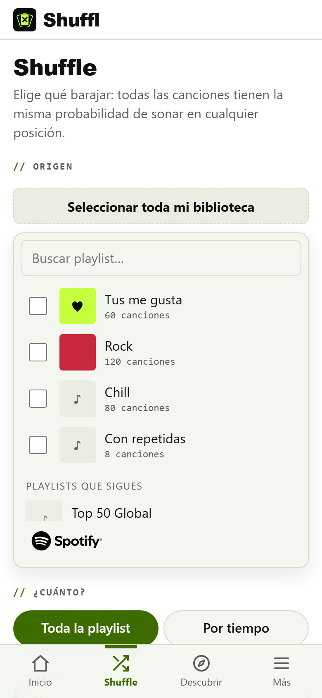

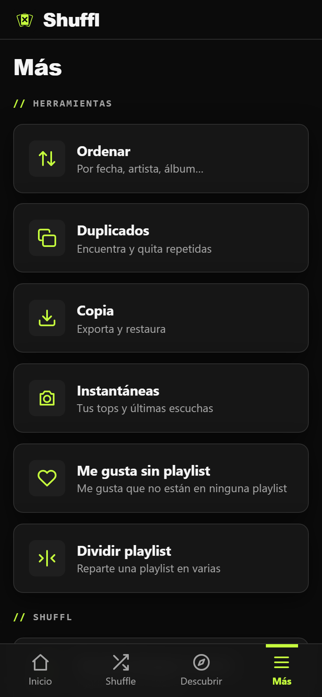

### Shuffle

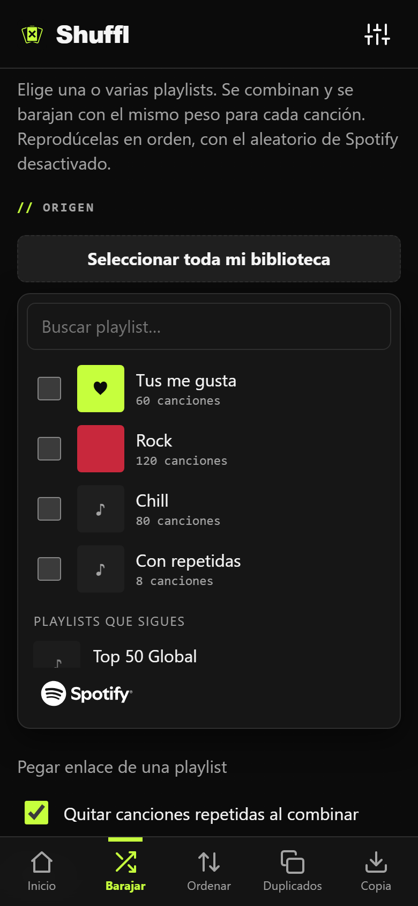

- Debajo de las playlists eliges **Toda la playlist** o **Por tiempo**. Por tiempo tiene accesos rápidos (🚗 Trayecto 20 min, 🏋️ Gym 45, 🏃 Correr 30, ✈️ Viaje 90, 😴 Dormir 30) y «A medida», con un deslizador de 5 a 180 min. Se baraja de forma uniforme y se llena el tiempo con ±2 min: «Gym 45 min · Shuffle» o, a medida, «Rock · 45 min · Shuffle». Las mezclas guardadas y los atajos de Siri recuerdan el tiempo.
- Quitar repetidas, filtros, destino, pegar enlace y guardar como mezcla también están en «Más opciones»; sin tocarlos funciona bien.

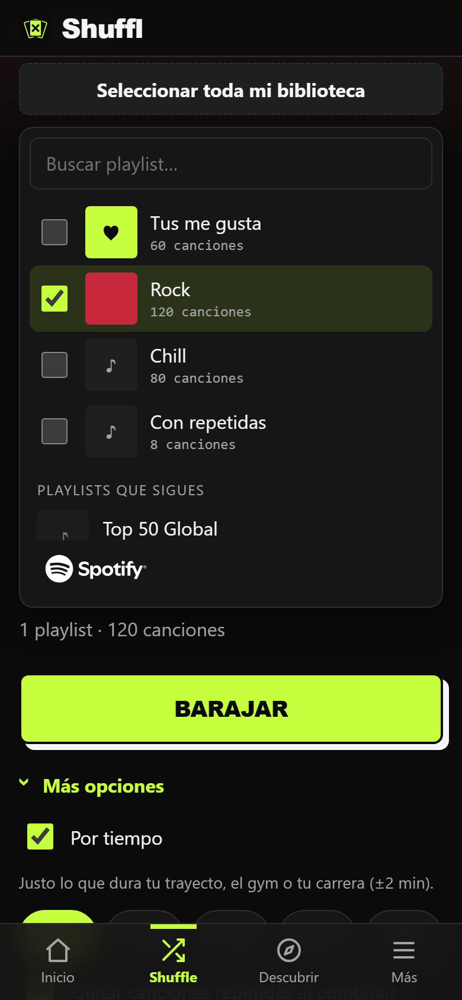

- Elige una o varias playlists y Tus me gusta: se combinan y se barajan juntas. Por defecto quita las canciones repetidas (misma URI) al combinar. Hay filtros previos (año, fecha de añadida, duración, explícitas): se aplican antes y luego se baraja de forma uniforme lo que queda.
- Destino:
  - Una playlist nueva de Shuffl (por defecto): «Reggaeton · Shuffle», «Tus me gusta · Shuffle», «Mix · Shuffle» (varias playlists; la descripción las lista), «Coche · Shuffle» (mezcla guardada) o «Toda mi música · Shuffle». Sustituye a la anterior de Shuffl (ver abajo).
  - La propia playlist, solo con una playlist tuya y con confirmación.
- La portada de la playlist generada lleva el icono de Shuffl, el nombre del origen y la fecha (se desactiva en Ajustes).
- El resultado enseña el nombre, las canciones y la duración, con «▶ Reproducir ahora» (Premium) y «Abrir en Spotify», y la lista de canciones con la carátula de su álbum. Desliza una canción a la izquierda (o toca su ×) para quitarla de la playlist; tira hacia abajo o toca «Volver a barajar» para rebarajarla al momento. También puedes compartirla o pulsar Deshacer.
- «Reproducir ahora» busca tu Spotify, pone la playlist desde la primera canción, apaga el aleatorio y comprueba que de verdad suena así. Si el móvil no está activo, pide abrir Spotify un momento; sin Premium, en un dispositivo que no se deja controlar o si Spotify no hace caso, lo explica y ofrece abrirla en Spotify.

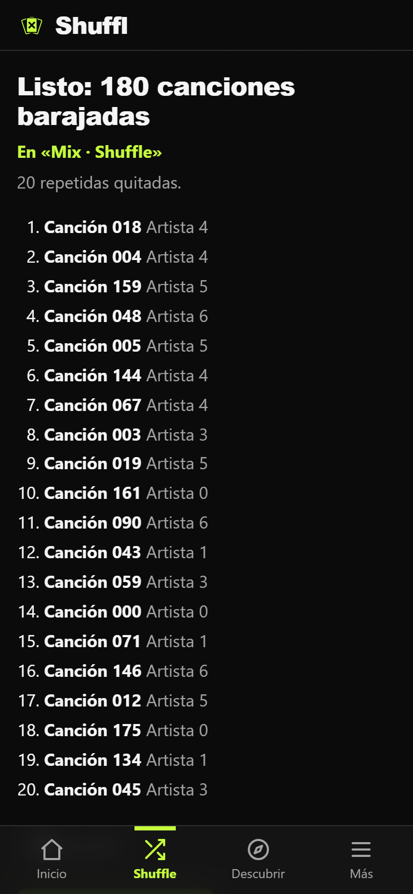

### Solo una playlist de Shuffl en tu cuenta

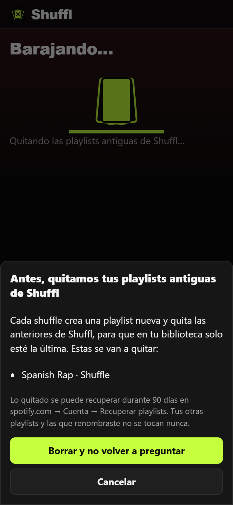

- Cada vez que Shuffl va a crear una playlist (shuffle, Descubrir, Olvidadas, Instantáneas, Mi top), primero lee las canciones, después quita de tu biblioteca todas las playlists que creó antes y por último crea la nueva. Así solo existe una, la última.
- Son de Shuffl las tuyas con su etiqueta en la descripción (` · shuffl:src=<hash>`, sin ids ni nombres) o, las de versiones anteriores, con un nombre «… · Shuffle», «📸 …» o «🔀 Baraja» y una descripción de las que ponía la app. Nunca se tocan las que renombraste, las de otras personas, las colaborativas ni las que no tienen esa descripción, y no se ofrecen como origen.
- La primera vez se enseña la lista con «Borrar y no volver a preguntar»; después es automático, con un aviso. Se desactiva en Ajustes. Lo quitado se recupera durante 90 días en spotify.com → Cuenta → Recuperar playlists.
- Si quitar o crear falla, se explica qué ha pasado con «Reintentar» (las canciones siguen en memoria). «Comprobar conexión», en Más → Diagnóstico, prueba que Shuffl puede quitar playlists.
- Como cada shuffle crea una playlist nueva, el pin de Tu biblioteca no se conserva: ordena Tu biblioteca por «Recientes» para tenerla arriba.

### Descubrir

Spotify ya no ofrece recomendaciones a apps como esta, así que Shuffl las busca a partir de lo que escuchas y sigues. Cada opción crea una playlist de Shuffl con portada y «Reproducir ahora».

- **Novedades**: lanzamientos de los últimos 7, 30 o 90 días.
- **Descubre**: canciones de los álbumes que escuchas y de tus artistas.
- En las dos: unas 30 canciones y «Buscar más» para añadir otras 30 a la misma playlist; en «Más opciones», número (15-100) o duración (30-90 min). Se basan en tus artistas, en una playlist tuya («Como mi playlist…») o en un género (si Spotify da géneros para tus artistas). Nunca salen canciones que ya tienes en tus playlists o en Tus me gusta.
- **Olvidadas**: 100 al azar entre tus Me gusta de hace más de 1, 2, 3 o 5 años.
- **Tu resumen**: tus 5 artistas y canciones top (4 semanas, 6 meses o siempre) en una tarjeta vertical para historias (1080×1920) y otra cuadrada, para compartir o descargar. Las carátulas van enteras y sin nada encima, junto al logo de Spotify. Puedes crear «Mi top · Shuffle».

Spotify limita cuántas peticiones hace cada app, así que Shuffl ahorra: cada búsqueda se para en unas 30 lecturas (en «Más opciones» eliges cuántos artistas mira cada vez), «Buscar más» sigue donde se quedó y lo leído se guarda en el dispositivo (IndexedDB): canciones de tus playlists mientras no cambien, álbumes 30 días, artistas y lanzamientos 24 h. Para no proponerte lo que ya tienes en Me gusta, solo pregunta por las canciones candidatas. Si Spotify corta a mitad, se guarda lo conseguido.

### Diagnóstico

En Más → Diagnóstico: cuántas peticiones lleva la sesión y el día (y cada acción), «Comprobar conexión», una **Prueba completa** que con tu cuenta comprueba paso a paso entrar, leer, crear, sobrescribir y quitar una playlist de prueba, tus dispositivos y la reproducción, y el registro de los últimos errores con «Copiar informe» (sin nombres ni tokens). Ningún error sale en código: siempre un mensaje claro con «Reintentar», «Volver a conectar» o «Abrir en Spotify».

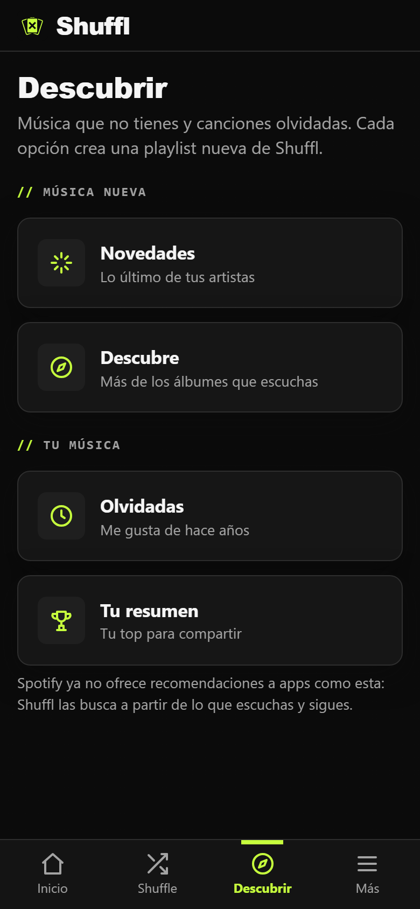

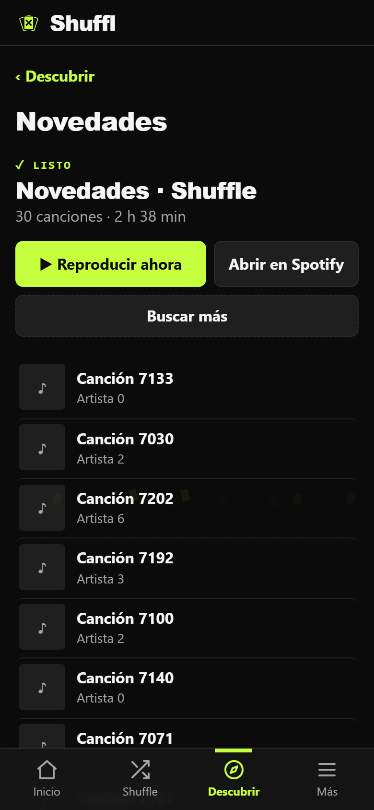

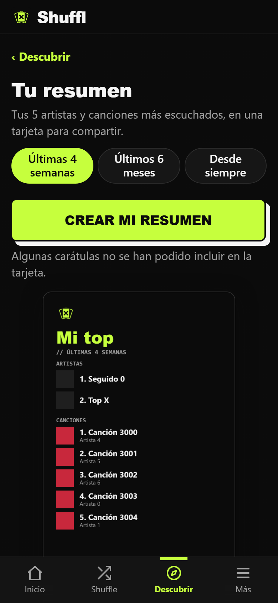

### Elige por mí y «¿Es aleatorio de verdad?»

- **Elige por mí**: una ruleta elige una de tus playlists, todas con la misma probabilidad (la elección se hace antes de animar), y la baraja en una playlist nueva de Shuffl.
- **¿Es aleatorio de verdad?**: simula 10.000 barajas de 10 canciones en tu dispositivo y enseña, con un gráfico de barras animado y una tabla, cuántas veces suena primero cada canción con el barajado de Shuffl (todas cerca del 10 %) y con un barajado sesgado (el error clásico de intercambiar cada canción con cualquier posición).

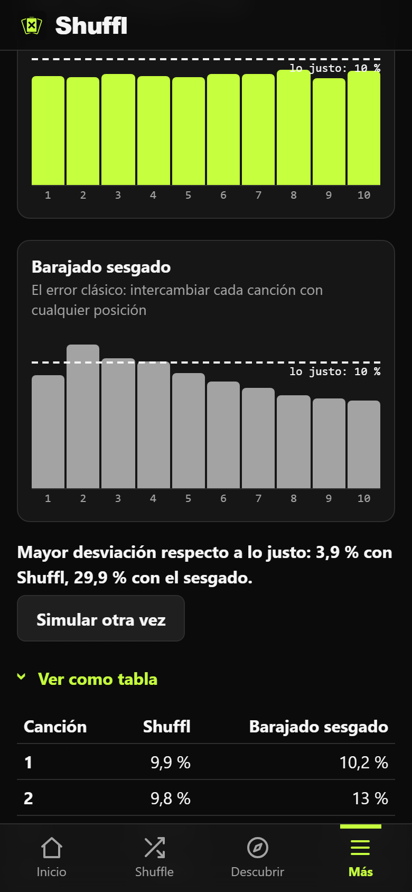

### Siri, atajos y coche

- Enlaces profundos: `?mezcla=<id>&play=1` rebaraja una mezcla guardada y la reproduce con el aleatorio de Spotify apagado; `?origen=<id de playlist>&play=1` hace lo mismo con una playlist. Solo se ejecutan con la sesión iniciada y si la mezcla o la playlist existen en ese navegador, siempre crean una playlist nueva de Shuffl (nunca escriben en el origen) y se quitan de la dirección al leerlos. Los atajos llevan una clave de ese navegador (`k`); un enlace sin ella, por ejemplo desde otra web, pide confirmación.
- Cada mezcla guardada tiene el botón «Crear atajo de Siri», con el enlace para copiar y los pasos en la app Atajos (acción «Abrir URL» y un nombre como «Shuffl coche»). En iPhone, Atajos abre el enlace en Safari, que no comparte datos con la app de la pantalla de inicio: hay que iniciar sesión, tener la mezcla y crear el atajo también desde Safari.
- CarPlay no admite apps web. Tu playlist de Shuffl sí aparece en Spotify dentro de CarPlay; la ayuda de «Tenerla siempre a mano» lo explica.

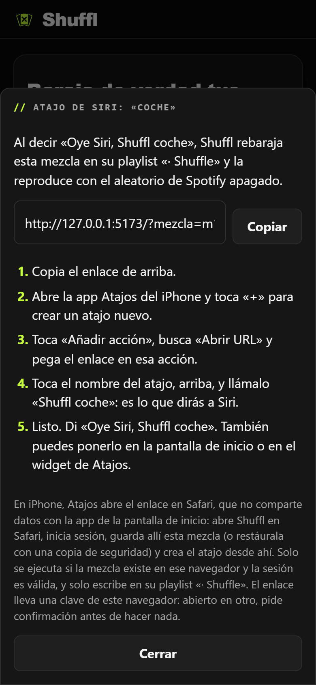

### Ordenar

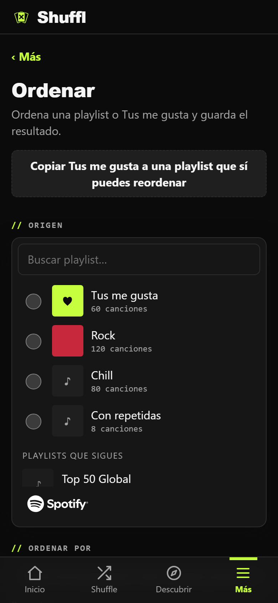

- Criterios: fecha de lanzamiento (ascendente y descendente), artista, álbum, título, duración (ascendente y descendente), fecha de añadida (ascendente y descendente), invertir.
- Atajo para copiar Tus me gusta a una playlist normal, que sí se puede reordenar.
- Filtro por fecha de añadida (desde y hasta, ambos opcionales).
- Destino: playlist nueva, o sobrescribir la propia (no disponible con Tus me gusta ni con el filtro de fechas).

### Duplicados

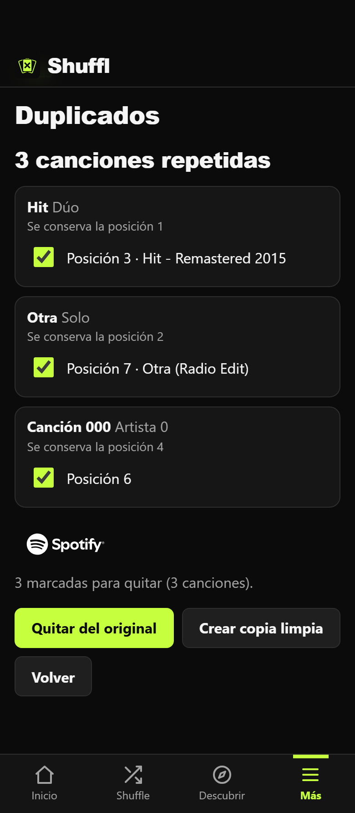

- Exacto: misma URI.
- Inteligente: mismo ISRC, o mismo título y artista aunque sea otra edición (remaster, radio edit). Live y Acoustic cuentan como versiones distintas.
- Se conserva la primera aparición. Eliges qué repetidas quitar y si lo haces en la playlist original (con Deshacer) o en una copia limpia.

### Copia y restaurar

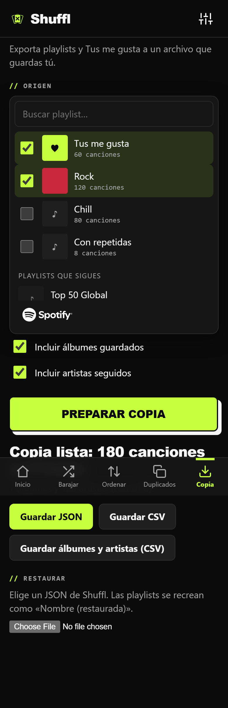

- Exporta las playlists elegidas (y Tus me gusta) a JSON o CSV. En móviles con soporte usa el menú de compartir; si no, descarga el archivo.
- Restaurar lee un JSON de Shuffl y crea una playlist nueva por cada una, con el sufijo «(restaurada)».

### Deshacer

Antes de sobrescribir una playlist, Shuffl guarda en el navegador las canciones y el orden anteriores. Ajustes tiene el botón Deshacer, y cada resultado lo ofrece para su playlist. Solo se guarda una copia: la última operación que sobrescribe.

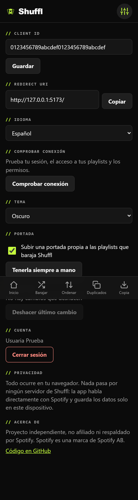
